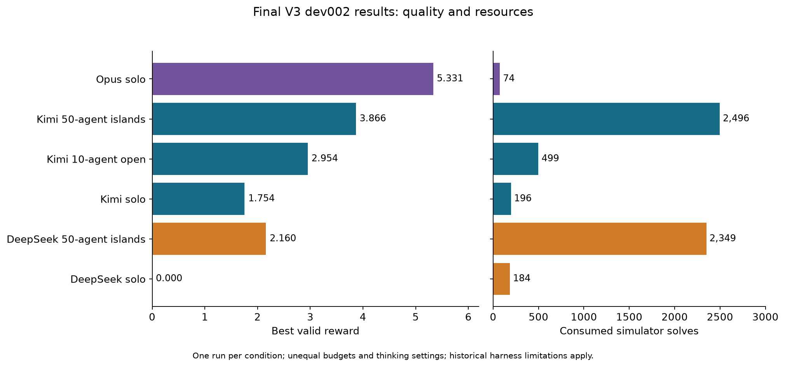

# Research report

## Can a swarm design a better chemical plant?

We studied whether groups of language-model agents could discover better chemical separation plants than a single agent, and whether sharing past experiments would help. Agents designed a plant, evaluated it with ChemSep, inspected the feedback, and revised their next proposal. We varied the model, number of agents, access to memory, and ways of sharing designs.

Larger swarms found the strongest team designs in our final experiment. A 50-agent Kimi swarm reached a reward of **3.866**, compared with **1.754** for Kimi alone. However, **Opus alone achieved the best result, 5.331**, using far fewer simulator solves. Sharing helped successful designs spread, but often led agents toward the same structure. Additional memory did not consistently improve results.

These are exploratory findings from one run per condition. Differences in budgets, model settings, and experiment software limit what we can conclude about the causes of the improvements.

## Main results

The final comparison used **V3 development task 002**, a 16-component hydrocarbon separation problem. Reward measures simulated annualized product value minus plant cost, normalized for the task. Higher is better; it is a benchmark score, not a prediction of realized profit.

| Model and configuration | Best reward | Simulator solves used | Solves allocated |
| --- | ---: | ---: | ---: |
| Opus, single agent | 5.331 | 74 | 200 |
| Kimi, 50-agent islands | 3.866 | 2,496 | 2,500 |
| Kimi, 10-agent open sharing | 2.954 | 499 | 500 |
| Kimi, single agent | 1.754 | 196 | 200 |
| DeepSeek, 50-agent islands | 2.160 | 2,349 | 2,500 |
| DeepSeek, single agent | 0.000 | 184 | 200 |

The best Kimi swarm achieved about **73% of the Opus score with 34 times as many simulator solves**. Swarms improved the observed results within a model, but did not outperform the strongest single agent or demonstrate better use of the simulator budget. The [complete results](docs/FINAL_RESULTS.md) include all 19 runs on this task, including two that stopped at their round limit.

## The design problem

A chemical plant must separate a mixed feed into products that meet purity requirements. Each additional column can improve separation, but also adds equipment and operating costs. A useful design must balance product value against those costs.

Our agents choose the separation structure and column settings. A simulator evaluates the proposed design and returns measurements that inform the next attempt. Agents repeat this loop within a fixed allocation of simulator solves. Humans set the task, choose the experimental conditions, and interpret the results; design proposals and revisions run autonomously.

We developed the task in stages. The initial version used 12 components. Later versions used 16 components, blends, premium products, and stronger cost penalties. V3 introduced side draws and double-effect columns, allowing more complex designs and energy-saving arrangements. Because these changes alter the problem, we compare scores within a task rather than treating all versions as a single competition. The [task specification](docs/TASK_V3.md) describes the objective and available design choices.

## 1. Establishing the single-agent baseline

We began by testing single agents on four V3 development tasks. Opus outperformed Kimi in each of these initial runs. Budgets and model settings differed, so this comparison shows the performance we observed without isolating why one model did better.

The early experiments suggested a difficulty worth investigating: an agent may need to build through several costly, unprofitable intermediate designs before reaching a useful plant. The [initial evaluation](docs/EVALUATION_2026-11-14.md) and [individual runs](results/results-so-far/v3-first-look.html) document those observations. They motivate the later experiments; they do not establish a causal explanation for the model difference.

## 2. Testing whether memory helps

Our first five-agent experiment revealed a practical problem. Saving an experiment did not ensure that another agent would see its design and feedback. Retrieval and oversized prompts could leave the most useful measured plant out of view.

We changed the information supplied to agents before testing memory again. Each agent received a compact description of the best design and recent measured experiments. We then tested whether **Past**, an additional retrieval service for older experiments, improved performance beyond that information.

On **V3 development task 000**, we compared one and five Kimi agents, with and without Past. Each agent had an allocation of 400 queries, giving the swarm five times the total budget of the single agent.

The sharing swarm without Past reached **$2.179 billion in simulated annualized net value**, compared with **$2.024 billion** for the single agent: a **7.65% increase**, using 1,978 versus 395 queries. At the same 395-query point, the single agent was ahead. Past did not improve the final score for either the single agent or the swarm.

The result supports a limited conclusion: sharing and a larger budget produced a higher final score in this experiment. It does not show that retrieval helped or that a swarm used its queries more efficiently. The [experimental protocol](docs/MEMORY_CONTROLS.md), [detailed comparison](results/hc16v3_dev_000/comparison/kimi-k3.1-pro/v3-400-analysis/index.html), and [query-by-query results](results/hc16v3_dev_000/comparison/kimi-k3.1-pro/v3-400-analysis/curves.csv) provide the methods and measurements.

## 3. Testing how agents should share

We next compared eight ways of organizing ten Kimi agents on **V3 development task 002**, with 500 total allocated queries. These included independent search, broadcasting the best design, sharing lessons, delayed sharing, different strategies, competing teams, specialist roles, and supervision.

Broadcasting helped all ten agents find positive-scoring plants, compared with four of ten under independent search. But the agents also converged: their final best designs contained just one separation structure, compared with four under independent search and five under delayed sharing.

Broadcasting reached a reward of **2.552**, independent search **2.428**, and delayed sharing **2.436**. A single-agent comparison had already reached **2.656** before a software error stopped it. This experiment therefore did not establish that a swarm outperformed a single agent.

The important observation was the tradeoff between spreading a useful design and preserving alternatives. It led us to test larger groups and island configurations, where agents search in smaller groups with intended exchanges between them. The [configuration descriptions](docs/SWARM_FRAMEWORKS.md) and [screening results](results/results-so-far/v3-screen.html) describe this comparison in detail.

## 4. Scaling up the swarms

For the final study, we added full views of other agents’ plants, individual notebooks, and the ability to reuse branches from another design. We compared independent search, open sharing, islands, and other arrangements on development task 002.

The 50-agent island configurations produced the strongest team results for both Kimi and DeepSeek. Kimi’s winning design used **13 column positions**. **49 of its 50 agents** found positive-scoring plants, and their retained best designs contained **16 distinct separation structures**. By comparison, the ten-agent open-sharing run retained one structure. All four ten-agent Kimi conditions exceeded the single-agent score, although they had roughly 500 allocated solves rather than 200.

Opus alone remained the best-performing condition. Its result shows why a stronger single-agent baseline matters: increasing the number of agents is only one way to spend additional resources, and it was not the most efficient option in this comparison.

The experiments also have an important software limitation. They ran before corrections to how designs were selected for exchange and how budgets were transferred in managed search. “Islands” describes the intended configuration; these runs do not isolate the benefit of periodic exchange. DeepSeek also used a thinking cap that Kimi and Opus did not. We therefore report the measured designs and scores without claiming that a particular exchange mechanism caused the improvement.

The [results dashboard](results/results-so-far/final-study.html) links to the saved designs, per-agent activity, and resource use. Seventeen runs finished normally; the DeepSeek culling and managed-search runs reached their round limits and are reported as partial results.

A separate Opus experiment on **development task 000** examined continued search. A run required to use at least 80% of its 200-solve allocation reached **2.726 at 160 solves**, while a freely stopping run reached **2.188 at 52 solves**. These were different search trajectories—the longer run was already ahead at 52 solves—so this is not a controlled measurement of the effect of forcing the same agent to continue. The [full results](docs/FINAL_RESULTS.md) keep this comparison separate from the task 002 results.

## 5. Examining the content of shared memory

A follow-up experiment tested a new shared library of compact experiment records. On development task 000, the five-agent immediate-sharing condition reached **0.521 at 1,990 queries**, compared with **2.324 at 395 queries** for the single agent. Recorded model costs were **$24.24** and **$4.73**, respectively. At the same 395-query point, the swarm had reached only **0.394**.

All five agents’ final best plants had the same topology. Records from the shared library did reach the prompts, but the selection method rotated through examples in insertion order without ranking their quality, recency, or relevance. Nearly all prompts approached the size limit.

These observations point to a question about the quality of the information agents receive, rather than simply how much is stored. They do not establish why the swarm performed poorly. Both completed runs passed the recorded accounting, objective, and material-balance checks. A delayed-sharing attempt was stopped shortly after starting, and a second delay condition was never started, so neither supports a comparison of sharing timing. The [follow-up analysis](results/results-so-far/corpus-comparison.html) contains the measurements and remaining uncertainties.

## Conclusions and limitations

Our experiments demonstrate an autonomous design loop: agents propose chemical plants, evaluate them, and use the results to revise their designs. Larger swarms found better team designs in the final comparison, but the strongest single agent achieved a higher score with substantially fewer simulator solves.

Sharing has two visible effects. It can spread a successful design to agents that would otherwise struggle, and it can concentrate their search around that design. Adding retrieval did not improve the completed memory comparison, and the later shared-library experiment performed worse than its single-agent baseline. More stored experience is therefore not sufficient; the selection and presentation of that experience deserve separate testing.

These studies used single runs, unequal budgets, and different task instances and software settings. They establish observed outcomes, not reliable estimates of average performance or proof of a particular mechanism. Repeated comparisons on the same task, with the corrected software and equal total budgets, would help separate the effects of group size, information selection, and exchange timing.

## Data and methods

The repository includes [experiment reports and saved designs](results/results-so-far/inventory.html), a [numerical appendix](results/results-so-far/ANALYSIS.md), and [instructions for reproducing and inspecting runs](docs/GETTING_STARTED.md). Individual reports link to the available measurements and logs. Some early experiments retain summaries without complete trajectories; later final-study reports include plant submissions and usage records. Live evaluations require ChemSep, while saved results and 3D plants can be inspected locally.
