# Research report

## Can a swarm design a better chemical plant?

We studied whether groups of language-model agents could discover better chemical separation plants than a single agent, and whether sharing past experiments would help. Agents designed a plant, evaluated it with ChemSep, inspected the feedback, and revised their next proposal. We varied the model, number of agents, access to memory, and ways of sharing designs.

Larger swarms found the strongest team designs in our final experiment. A 50-agent Kimi swarm reached a reward of **3.866**, compared with **1.754** for Kimi alone. However, **Opus alone achieved the best result, 5.331**, using far fewer simulator solves. Sharing helped successful designs spread, but often led agents toward the same structure. Additional memory did not consistently improve results.

These are exploratory findings from one run per condition. Differences in budgets, model settings, and experiment software limit what we can conclude about the causes of the improvements.

## Main results

The final comparison used **V3 development task 002**, a 16-component hydrocarbon separation problem. Reward measures simulated annualized product value minus plant cost, normalized for the task. Higher is better; it is a benchmark score, not a prediction of realized profit.

| Model and configuration | Best reward | Simulator solves used | Solves allocated |
| --- | ---: | ---: | ---: |
| Opus, single agent | 5.331 | 74 | 200 |
| Kimi, 50-agent islands | 3.866 | 2,496 | 2,500 |
| Kimi, 10-agent open sharing | 2.954 | 499 | 500 |
| Kimi, single agent | 1.754 | 196 | 200 |
| DeepSeek, 50-agent islands | 2.160 | 2,349 | 2,500 |
| DeepSeek, single agent | 0.000 | 184 | 200 |

The best Kimi swarm achieved about **73% of the Opus score with 34 times as many simulator solves**. Swarms improved the observed results within a model, but did not outperform the strongest single agent or demonstrate better use of the simulator budget. The [complete results](docs/FINAL_RESULTS.md) include all 19 runs on this task, including two that stopped at their round limit.

## The design problem

A chemical plant must separate a mixed feed into products that meet purity requirements. Each additional column can improve separation, but also adds equipment and operating costs. A useful design must balance product value against those costs.

Our agents choose the separation structure and column settings. A simulator evaluates the proposed design and returns measurements that inform the next attempt. Agents repeat this loop within a fixed allocation of simulator solves. Humans set the task, choose the experimental conditions, and interpret the results; design proposals and revisions run autonomously.

We developed the task in stages. The initial version used 12 components. Later versions used 16 components, blends, premium products, and stronger cost penalties. V3 introduced side draws and double-effect columns, allowing more complex designs and energy-saving arrangements. Because these changes alter the problem, we compare scores within a task rather than treating all versions as a single competition. The [task specification](docs/TASK_V3.md) describes the objective and available design choices.

## How to read the experiments

The sections below follow the development of the task and the experiments it motivated. Each completed condition has an individual figure, its consumed and allocated budget, and a link to its measurements. Relevant incomplete controls are labeled separately. A zero score is an experimental result, not a setup test.

Search curves show the best score observed so far against total charged queries. They stop at the measured endpoint. Where a complete curve is unavailable, the figure shows the endpoint and resource use instead. Agent distributions show differences within one swarm; those agents are not independent repetitions of the whole experiment. Reward scales are shared within each study, but different task versions must not be ranked together. Costs are recorded model estimates and exclude simulator hosting and memory services.

## 1. Early baseline: the 12-component task

The first completed pilots established that a language-model agent could run the propose–simulate–revise loop on a chemical separation problem. At a 50-query allocation, Sol reached 3.3784 and Luna reached 0.7750. A separate Sol run with 200 allocated queries reached 3.1705. The longer search did not exceed the shorter search in these two realizations. More budget creates an opportunity for improvement; it does not guarantee that an independently started run follows a better path.

The following three completed pilots belong to HC12. Four other early model attempts were interrupted by API errors and remain in the experiment inventory, rather than being counted as completed baselines. We use these pilots to establish the working search loop, not to rank performance against the later 16-component tasks.

<!-- experiments:hc12 -->

### Sol: 50-query pilot — HC12

**Completed.** Best reward **3.3784**, using **50 of 50** allocated queries. Estimated model cost: **not recorded**.

This is an initial single-agent reference. Model settings and consumed budgets differ between runs, so the result does not isolate model quality from search depth.

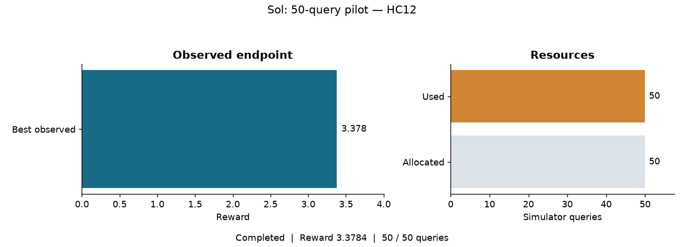

Only the measured endpoint is plotted here; this summary does not establish the path taken to reach it. [Measurements for this run](results/experimental-history-20261115/evidence/gpt-6.1-sol-pilot-20261114T220604Z-summary.json). Run ID: `gpt-6.1-sol-pilot-20261114T220604Z`.

### Luna: 50-query pilot — HC12

**Completed.** Best reward **0.7750**, using **50 of 50** allocated queries. Estimated model cost: **not recorded**.

This is an initial single-agent reference. Model settings and consumed budgets differ between runs, so the result does not isolate model quality from search depth.

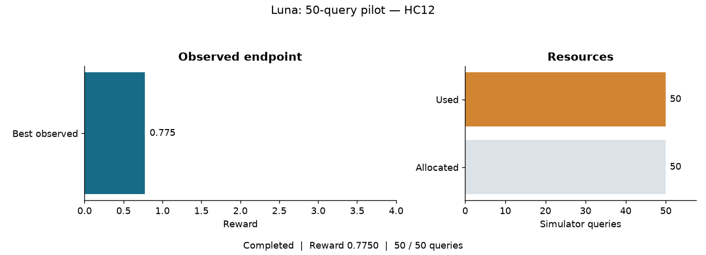

Only the measured endpoint is plotted here; this summary does not establish the path taken to reach it. [Measurements for this run](results/experimental-history-20261115/evidence/luna-pilot-20261114T211810Z-summary.json). Run ID: `luna-pilot-20261114T211810Z`.

### Sol: 200-query pilot — HC12

**Completed.** Best reward **3.1705**, using **200 of 200** allocated queries. Estimated model cost: **not recorded**.

This is an initial single-agent reference. Model settings and consumed budgets differ between runs, so the result does not isolate model quality from search depth.

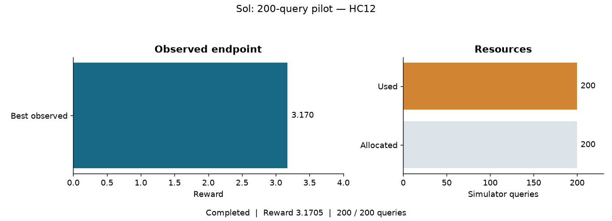

Only the measured endpoint is plotted here; this summary does not establish the path taken to reach it. [Measurements for this run](results/experimental-history-20261115/evidence/sol-200-20261114-summary.json). Run ID: `sol-200-20261114`.

<!-- /experiments:hc12 -->

## 2. V2: richer economics and the first memory comparison

The next task introduced 16 components, blended products, premium pricing, and stronger cost penalties. Four Opus runs explored different development tasks. Their scores ranged from 3.6292 to 7.3802, but those task instances have different inputs and economics; this spread is not a measure of repeatability.

On V2 task 000, Kimi alone reached 3.4219 after 200 queries. The five-agent memory swarm reached 3.3566 after 454 queries. The swarm therefore did not improve on this solo endpoint, despite using more simulator queries. The two conditions also had different stopping constraints, and the memory experiment exposed problems in delivering feedback and keeping useful records visible to agents.

This result changed our next experiment. Before asking whether retrieval improves research, we needed to make sure agents reliably receive the best measured design and recent results. The later V3 controls addressed that information-delivery problem. The V2 result cannot establish how the corrected memory arrangement performs.

<!-- experiments:v2 -->

### Opus: Solo — task 000

**Completed.** Best reward **3.6292**, using **106 of 400** allocated queries. Estimated model cost: **$2.86**.

V2 has different economics and design choices from V3. Compare this score within the task; it is not part of the final V3 leaderboard.

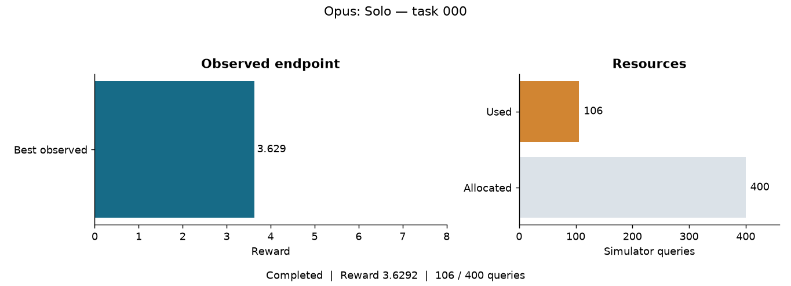

Only the measured endpoint is plotted here; this summary does not establish the path taken to reach it. [Measurements for this run](results/experimental-history-20261115/evidence/hc16v2_dev_000_anthropic_claude-opus-5-5_s0_ab9fe8-summary.json). Run ID: `hc16v2_dev_000_anthropic_claude-opus-5-5_s0_ab9fe8`.

### Kimi: Five-agent memory swarm — task 000

**Completed.** Best reward **3.3566**, using **454 of 500** allocated queries. Estimated model cost: **$19.73**.

V2 has different economics and design choices from V3. Compare this score within the task; it is not part of the final V3 leaderboard.

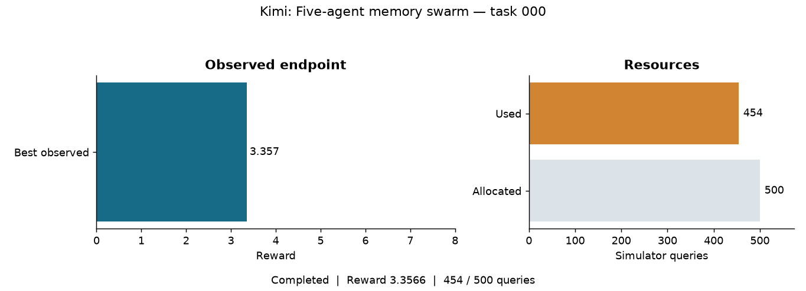

Only the measured endpoint is plotted here; this summary does not establish the path taken to reach it. [Measurements for this run](results/experimental-history-20261115/evidence/swarm-a1b45716fe3444679f33125db48b89b7-summary.json). Run ID: `swarm-a1b45716fe3444679f33125db48b89b7`.

### Kimi: Solo — task 000

**Completed.** Best reward **3.4219**, using **200 of 200** allocated queries. Estimated model cost: **$1.26**.

V2 has different economics and design choices from V3. Compare this score within the task; it is not part of the final V3 leaderboard.

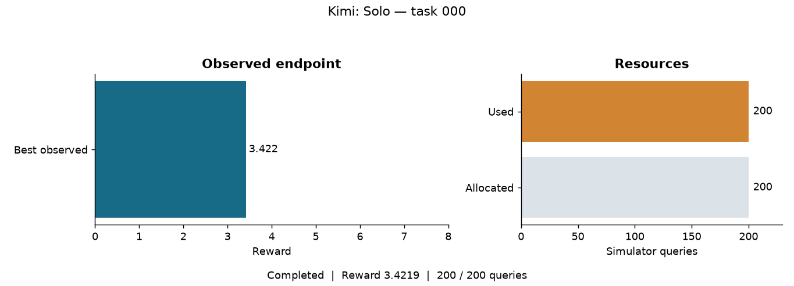

Only the measured endpoint is plotted here; this summary does not establish the path taken to reach it. [Measurements for this run](results/experimental-history-20261115/evidence/v2-kimi-20261114-r3-single-summary.json). Run ID: `v2-kimi-20261114-r3-single`.

### Opus: Solo — task 001

**Completed.** Best reward **4.6312**, using **113 of 400** allocated queries. Estimated model cost: **$2.88**.

V2 has different economics and design choices from V3. Compare this score within the task; it is not part of the final V3 leaderboard.

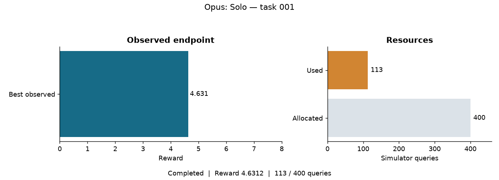

Only the measured endpoint is plotted here; this summary does not establish the path taken to reach it. [Measurements for this run](results/experimental-history-20261115/evidence/hc16v2_dev_001_anthropic_claude-opus-5-5_s0_78f86c-summary.json). Run ID: `hc16v2_dev_001_anthropic_claude-opus-5-5_s0_78f86c`.

### Opus: Solo — task 002

**Completed.** Best reward **7.3802**, using **204 of 400** allocated queries. Estimated model cost: **$4.98**.

V2 has different economics and design choices from V3. Compare this score within the task; it is not part of the final V3 leaderboard.

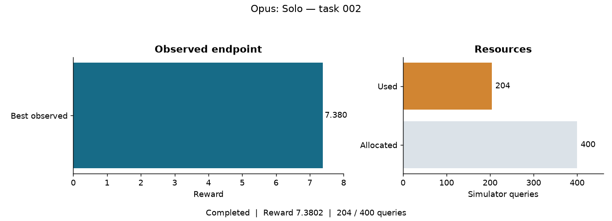

Only the measured endpoint is plotted here; this summary does not establish the path taken to reach it. [Measurements for this run](results/experimental-history-20261115/evidence/hc16v2_dev_002_anthropic_claude-opus-5-5_s0_cc9fc9-summary.json). Run ID: `hc16v2_dev_002_anthropic_claude-opus-5-5_s0_cc9fc9`.

### Opus: Solo — task 003

**Completed.** Best reward **5.1934**, using **153 of 400** allocated queries. Estimated model cost: **$3.69**.

V2 has different economics and design choices from V3. Compare this score within the task; it is not part of the final V3 leaderboard.

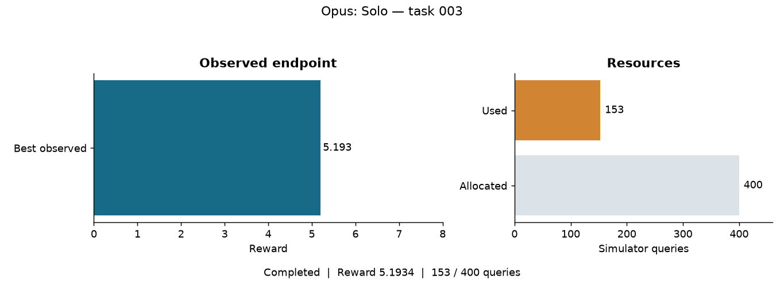

Only the measured endpoint is plotted here; this summary does not establish the path taken to reach it. [Measurements for this run](results/experimental-history-20261115/evidence/hc16v2_dev_003_anthropic_claude-opus-5-5_s0_19f2a3-summary.json). Run ID: `hc16v2_dev_003_anthropic_claude-opus-5-5_s0_19f2a3`.

<!-- /experiments:v2 -->

## 3. V3: establishing the single-agent baseline

We began by testing single agents on four V3 development tasks. Opus outperformed Kimi in each of these initial runs. Budgets and model settings differed, so this comparison shows the performance we observed without isolating why one model did better.

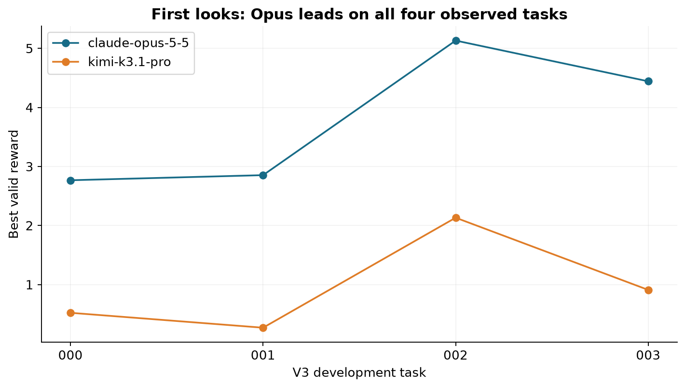

The early experiments suggested a difficulty worth investigating: an agent may need to build through several costly, unprofitable intermediate designs before reaching a useful plant. The [initial evaluation](docs/EVALUATION_2026-11-14.md) and [individual runs](results/results-so-far/v3-first-look.html) document those observations. They motivate the later experiments; they do not establish a causal explanation for the model difference.

<!-- experiments:v3-first-look -->

### Opus: Solo — task 000

**Completed.** Best reward **2.7669**, using **233 of 400** allocated queries. Estimated model cost: **$4.18**.

This is an initial single-agent reference. Model settings and consumed budgets differ between runs, so the result does not isolate model quality from search depth.

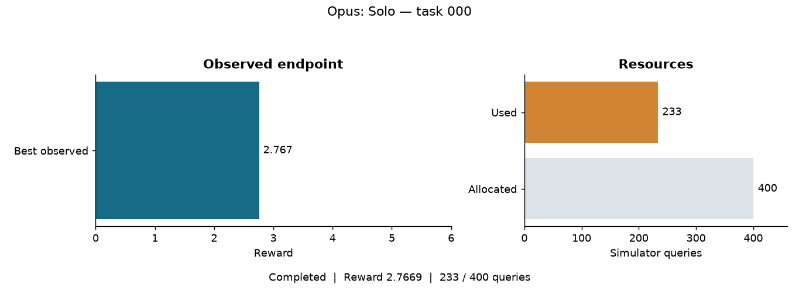

Only the measured endpoint is plotted here; this summary does not establish the path taken to reach it. [Measurements for this run](results/experimental-history-20261115/evidence/hc16v3_dev_000_anthropic_claude-opus-5-5_s0_ea02f9-summary.json). Run ID: `hc16v3_dev_000_anthropic_claude-opus-5-5_s0_ea02f9`.

### Kimi: Solo — task 000

**Completed.** Best reward **0.5220**, using **195 of 200** allocated queries. Estimated model cost: **$1.46**.

This is an initial single-agent reference. Model settings and consumed budgets differ between runs, so the result does not isolate model quality from search depth.

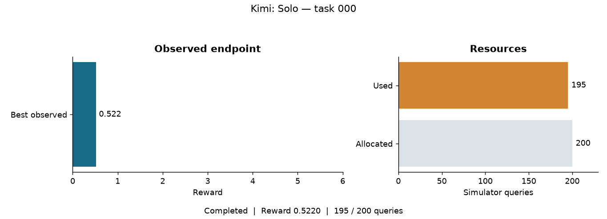

Only the measured endpoint is plotted here; this summary does not establish the path taken to reach it. [Measurements for this run](results/experimental-history-20261115/evidence/swarm-screening/results/hc16v3-first-look/kimi-k3.1-pro/hc16v3_dev_000_modal_kimi-k3.1-pro_s0_36e659/summary.json). Run ID: `hc16v3_dev_000_modal_kimi-k3.1-pro_s0_36e659`.

### Opus: Solo — task 001

**Completed.** Best reward **2.8531**, using **153 of 400** allocated queries. Estimated model cost: **$4.45**.

This is an initial single-agent reference. Model settings and consumed budgets differ between runs, so the result does not isolate model quality from search depth.

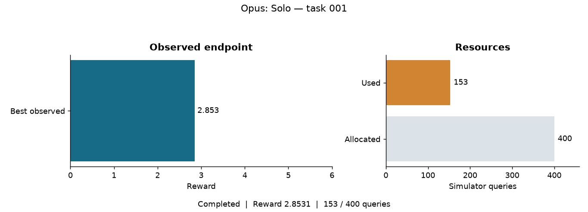

Only the measured endpoint is plotted here; this summary does not establish the path taken to reach it. [Measurements for this run](results/experimental-history-20261115/evidence/hc16v3_dev_001_anthropic_claude-opus-5-5_s0_3413a2-summary.json). Run ID: `hc16v3_dev_001_anthropic_claude-opus-5-5_s0_3413a2`.

### Kimi: Solo — task 001

**Completed.** Best reward **0.2695**, using **195 of 200** allocated queries. Estimated model cost: **$2.30**.

This is an initial single-agent reference. Model settings and consumed budgets differ between runs, so the result does not isolate model quality from search depth.

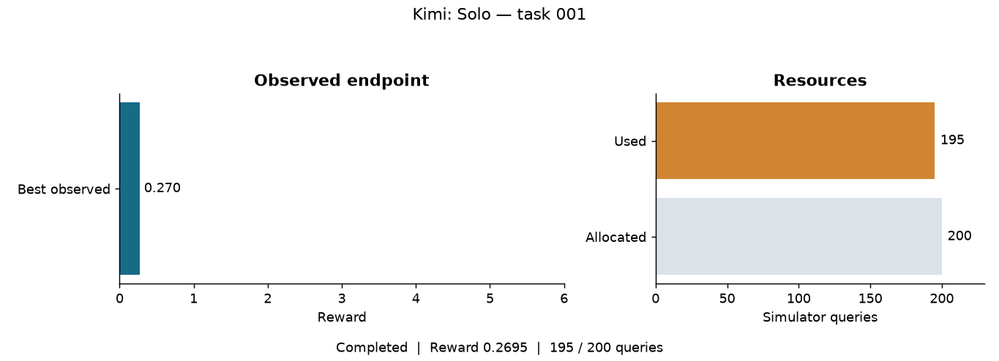

Only the measured endpoint is plotted here; this summary does not establish the path taken to reach it. [Measurements for this run](results/experimental-history-20261115/evidence/swarm-screening/results/hc16v3-first-look/kimi-k3.1-pro/hc16v3_dev_001_modal_kimi-k3.1-pro_s0_8a718e/summary.json). Run ID: `hc16v3_dev_001_modal_kimi-k3.1-pro_s0_8a718e`.

### Opus: Solo — task 002

**Completed.** Best reward **5.1323**, using **110 of 400** allocated queries. Estimated model cost: **$2.58**.

This is an initial single-agent reference. Model settings and consumed budgets differ between runs, so the result does not isolate model quality from search depth.

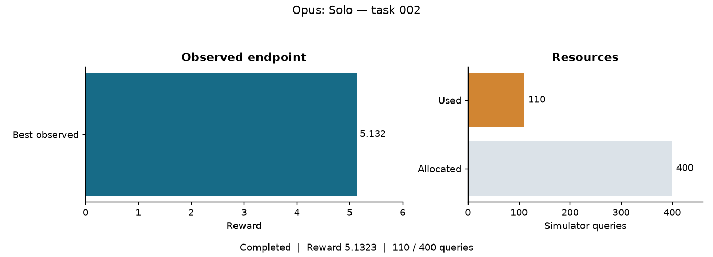

Only the measured endpoint is plotted here; this summary does not establish the path taken to reach it. [Measurements for this run](results/experimental-history-20261115/evidence/hc16v3_dev_002_anthropic_claude-opus-5-5_s0_49f7ac-summary.json). Run ID: `hc16v3_dev_002_anthropic_claude-opus-5-5_s0_49f7ac`.

### Kimi: Solo — task 002

**Completed.** Best reward **2.1325**, using **200 of 200** allocated queries. Estimated model cost: **$2.15**.

This is an initial single-agent reference. Model settings and consumed budgets differ between runs, so the result does not isolate model quality from search depth.

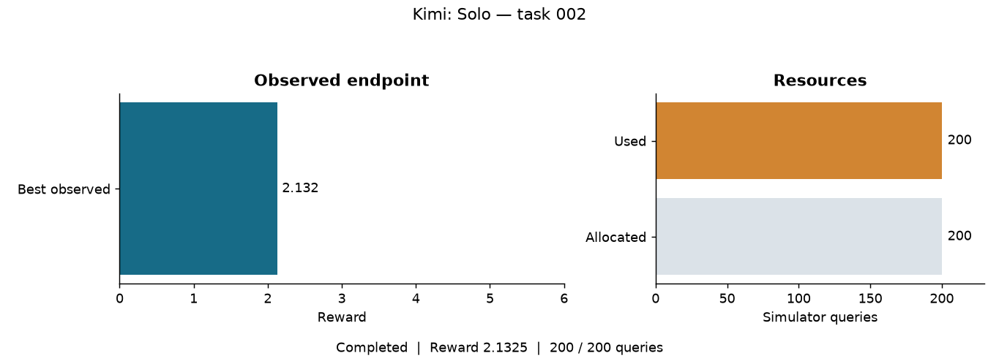

Only the measured endpoint is plotted here; this summary does not establish the path taken to reach it. [Measurements for this run](results/experimental-history-20261115/evidence/swarm-screening/results/hc16v3-first-look/kimi-k3.1-pro/hc16v3_dev_002_modal_kimi-k3.1-pro_s0_baf08c/summary.json). Run ID: `hc16v3_dev_002_modal_kimi-k3.1-pro_s0_baf08c`.

### Opus: Solo — task 003

**Completed.** Best reward **4.4425**, using **284 of 400** allocated queries. Estimated model cost: **$4.14**.

This is an initial single-agent reference. Model settings and consumed budgets differ between runs, so the result does not isolate model quality from search depth.

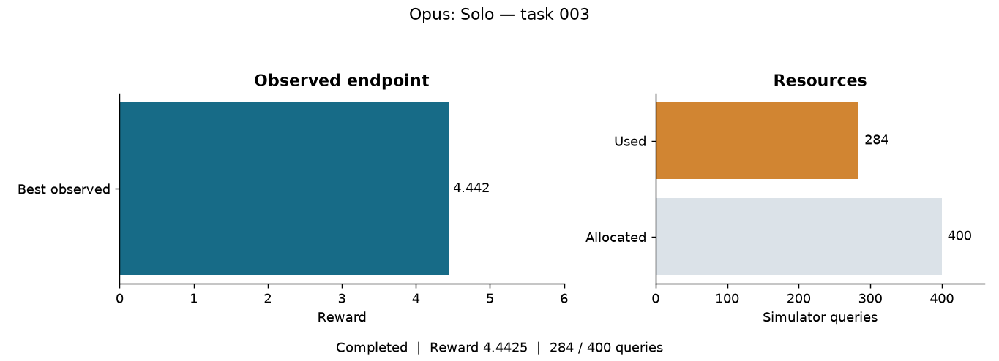

Only the measured endpoint is plotted here; this summary does not establish the path taken to reach it. [Measurements for this run](results/experimental-history-20261115/evidence/hc16v3_dev_003_anthropic_claude-opus-5-5_s0_2f665d-summary.json). Run ID: `hc16v3_dev_003_anthropic_claude-opus-5-5_s0_2f665d`.

### Kimi: Solo — task 003

**Completed.** Best reward **0.9099**, using **190 of 200** allocated queries. Estimated model cost: **$1.86**.

This is an initial single-agent reference. Model settings and consumed budgets differ between runs, so the result does not isolate model quality from search depth.

Only the measured endpoint is plotted here; this summary does not establish the path taken to reach it. [Measurements for this run](results/experimental-history-20261115/evidence/swarm-screening/results/hc16v3-first-look/kimi-k3.1-pro/hc16v3_dev_003_modal_kimi-k3.1-pro_s0_8bb44d/summary.json). Run ID: `hc16v3_dev_003_modal_kimi-k3.1-pro_s0_8bb44d`.

<!-- /experiments:v3-first-look -->

## 4. A short pilot of exact results and retrieval

Before allocating 400 queries per agent, we ran a shorter pilot with 100 per agent. Kimi solo with exact results reached 0.4255; adding Past retrieval reached 0.6060. The five-agent exact-sharing swarm reached 2.0698 with 488 total consumed queries. This pilot shows why the later experiment needed to report both total team budget and per-agent search depth: the swarm had about five times as much total opportunity to evaluate designs.

The apparent benefit of retrieval in this short solo pilot did not persist in the longer completed comparison. These are independent trajectories under evolving software, not repeated samples from a fixed protocol. We retain both results so the later finding is understood in the context of what prompted it.

<!-- experiments:v3-100 -->

### Kimi: Five agents, exact sharing — task 000

**Completed.** Best reward **2.0698**, using **488 of 500** allocated queries. Estimated model cost: **$5.78**.

This pilot preceded the longer memory experiment. Its outcome is a separate search trajectory, not an earlier checkpoint of the later 400-query run.

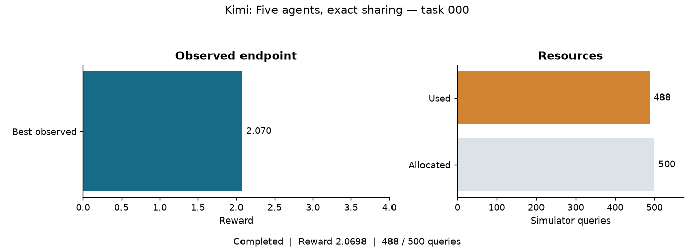

Only the measured endpoint is plotted here; this summary does not establish the path taken to reach it. [Measurements for this run](results/experimental-history-20261115/evidence/v3-100-campaign-snapshot.json). Run ID: `swarm-543232b4170f4d8b9496a6824c30f029`.

### Kimi: Solo, exact results — task 000

**Completed.** Best reward **0.4255**, using **100 of 100** allocated queries. Estimated model cost: **$1.33**.

This pilot preceded the longer memory experiment. Its outcome is a separate search trajectory, not an earlier checkpoint of the later 400-query run.

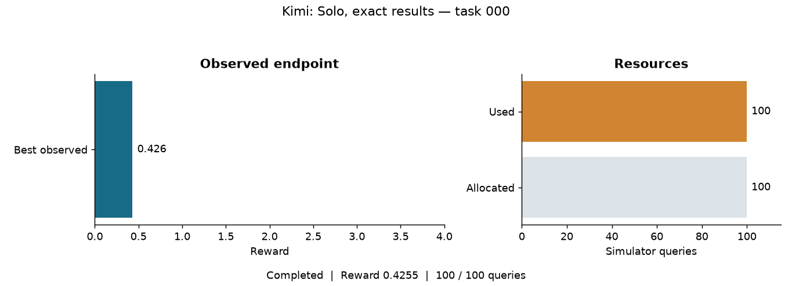

Only the measured endpoint is plotted here; this summary does not establish the path taken to reach it. [Measurements for this run](results/experimental-history-20261115/evidence/v3-100-campaign-snapshot.json). Run ID: `swarm-5495ec4fea6c47a19b99c3e0cf21d42f`.

### Kimi: Solo, Past retrieval — task 000

**Completed.** Best reward **0.6060**, using **100 of 100** allocated queries. Estimated model cost: **$1.82**.

This pilot preceded the longer memory experiment. Its outcome is a separate search trajectory, not an earlier checkpoint of the later 400-query run.

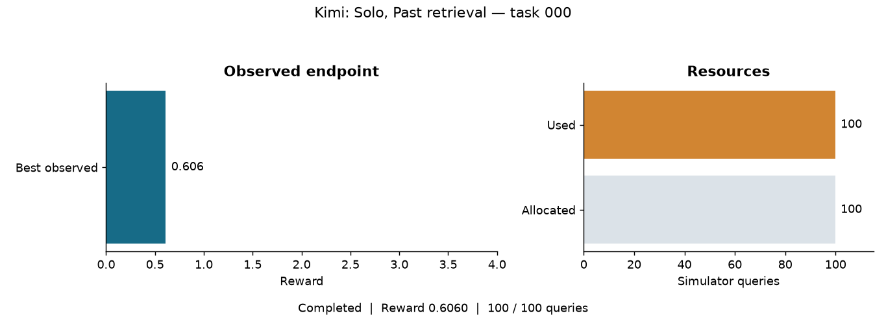

Only the measured endpoint is plotted here; this summary does not establish the path taken to reach it. [Measurements for this run](results/experimental-history-20261115/evidence/v3-100-campaign-snapshot.json). Run ID: `swarm-66df0079cddd45de96f67a6ed20fe47d`.

<!-- /experiments:v3-100 -->

## 5. Testing whether memory helps

Our first five-agent experiment revealed a practical problem. Saving an experiment did not ensure that another agent would see its design and feedback. Retrieval and oversized prompts could leave the most useful measured plant out of view.

We changed the information supplied to agents before testing memory again. Each agent received a compact description of the best design and recent measured experiments. We then tested whether **Past**, an additional retrieval service for older experiments, improved performance beyond that information.

On **V3 development task 000**, we compared one and five Kimi agents, with and without Past. Each agent had an allocation of 400 queries, giving the swarm five times the total budget of the single agent.

The sharing swarm without Past reached **$2.179 billion in simulated annualized net value**, compared with **$2.024 billion** for the single agent: a **7.65% increase**, using 1,978 versus 395 queries. At the same 395-query point, the single agent was ahead. Past did not improve the final score for either the single agent or the swarm.

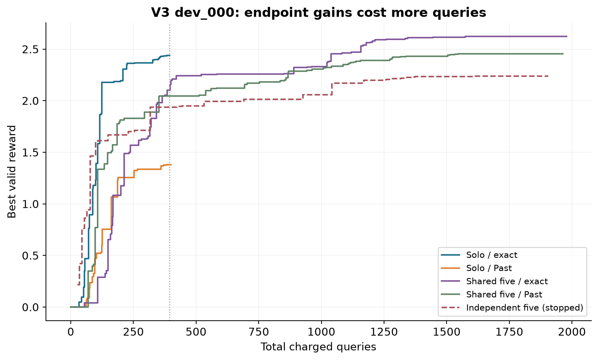

The result supports a limited conclusion: sharing and a larger budget produced a higher final score in this experiment. It does not show that retrieval helped or that a swarm used its queries more efficiently. The [experimental protocol](docs/MEMORY_CONTROLS.md), [detailed comparison](results/hc16v3_dev_000/comparison/kimi-k3.1-pro/v3-400-analysis/index.html), and [query-by-query results](results/hc16v3_dev_000/comparison/kimi-k3.1-pro/v3-400-analysis/curves.csv) provide the methods and measurements.

<!-- experiments:v3-400 -->

### Kimi: Five independent agents — task 000

**Stopped early.** Best reward **2.2395**, using **1,906 of 2,000** allocated queries. Estimated model cost: **$25.93**.

The curve uses total charged queries across the team, so it can be compared at the same query cutoff as solo. The larger allocation is not an equal-budget control.

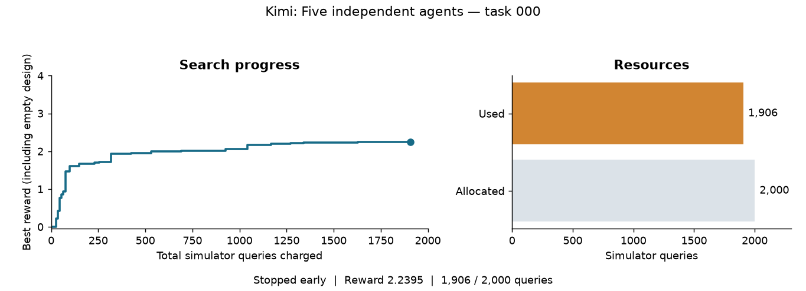

Best-so-far values are shown only through the observed query count; the line is not extended into the unused allocation. [Measurements for this run](results/hc16v3_dev_000/comparison/kimi-k3.1-pro/v3-400-analysis/independent_curves.csv). Run ID: `swarm-3c4ef43770314f2d96d51757b37f47c7`.

### Kimi: Solo, exact results — task 000

**Completed.** Best reward **2.4383**, using **395 of 400** allocated queries. Estimated model cost: **$6.83**.

This single-agent condition supplies the baseline for separating extra retrieval from the exact results already supplied in each prompt.

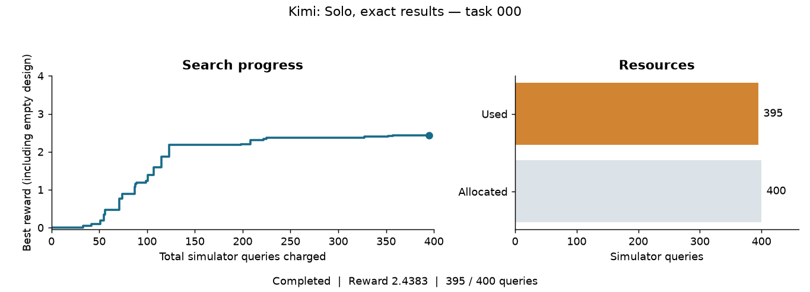

Best-so-far values are shown only through the observed query count; the line is not extended into the unused allocation. [Measurements for this run](results/hc16v3_dev_000/comparison/kimi-k3.1-pro/v3-400-analysis/curves.csv). Run ID: `swarm-5006f87b620d4f0da586b996e2358009`.

### Kimi: Five agents, Past retrieval — task 000

**Completed.** Best reward **2.4553**, using **1,963 of 2,000** allocated queries. Estimated model cost: **$15.59**.

The curve uses total charged queries across the team, so it can be compared at the same query cutoff as solo. The larger allocation is not an equal-budget control.

Best-so-far values are shown only through the observed query count; the line is not extended into the unused allocation. [Measurements for this run](results/hc16v3_dev_000/comparison/kimi-k3.1-pro/v3-400-analysis/curves.csv). Run ID: `swarm-72cb1e123ba9413e9c715b38544c0067`.

### Kimi: Five agents, exact sharing — task 000

**Completed.** Best reward **2.6249**, using **1,978 of 2,000** allocated queries. Estimated model cost: **$19.81**.

The curve uses total charged queries across the team, so it can be compared at the same query cutoff as solo. The larger allocation is not an equal-budget control.

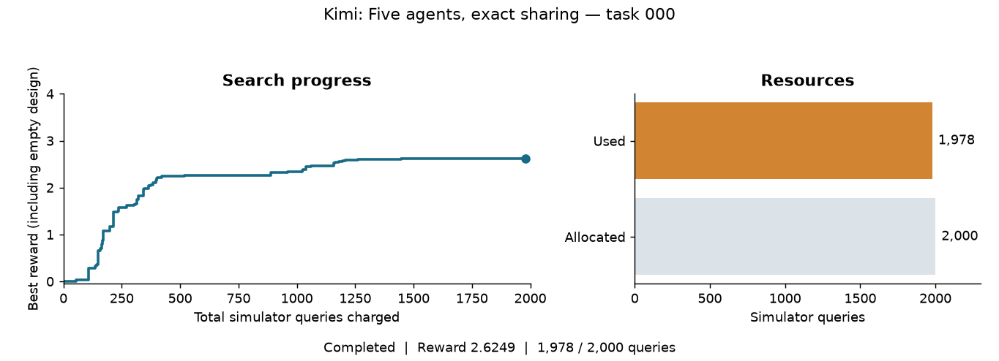

Best-so-far values are shown only through the observed query count; the line is not extended into the unused allocation. [Measurements for this run](results/hc16v3_dev_000/comparison/kimi-k3.1-pro/v3-400-analysis/curves.csv). Run ID: `swarm-99005c2897f049e8bf38ddfb0eefd900`.

### Kimi: Solo, Past retrieval — task 000

**Completed.** Best reward **1.3800**, using **400 of 400** allocated queries. Estimated model cost: **$5.96**.

This single-agent condition supplies the baseline for separating extra retrieval from the exact results already supplied in each prompt.

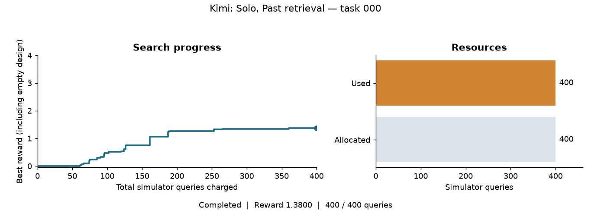

Best-so-far values are shown only through the observed query count; the line is not extended into the unused allocation. [Measurements for this run](results/hc16v3_dev_000/comparison/kimi-k3.1-pro/v3-400-analysis/curves.csv). Run ID: `swarm-ee547757b06143bbbd3cab016ebc93f5`.

<!-- /experiments:v3-400 -->

### What the budget comparison changes

The completed no-Past swarm scored 2.6249 at its endpoint, but only 2.1029 at the same 395-query cutoff as the completed solo run, which scored 2.4383. Reporting only the final scores would hide that distinction. The stopped independent swarm reached 2.2395 after 1,906 queries and 1.9360 at 395 queries. It preserved alternatives, but did not exceed the completed shared swarm or solo endpoint.

Past reduced the observed final reward from 2.4383 to 1.3800 for solo, and from 2.6249 to 2.4553 for the shared swarm. This is a result for the deployed retrieval pipeline. The prompt-admission analysis found many candidate memories omitted because exact current-state information and recent measurements took priority. A record being saved or returned by a search was therefore not equivalent to that record informing an agent’s next decision.

### Economics and sensitivity of the winning plants

The highest nominal score also deserves examination beyond the reward alone. In the five-agent no-Past plant, several product purities lay just above their qualification thresholds. Holding flows and plant costs fixed, raising the grading threshold by 0.05 percentage points reduced modeled net value by 29.62%. The corresponding loss was 20.01% for the Past swarm and 3.73% for the stopped independent control; the two solo plants lost nothing at that increment.

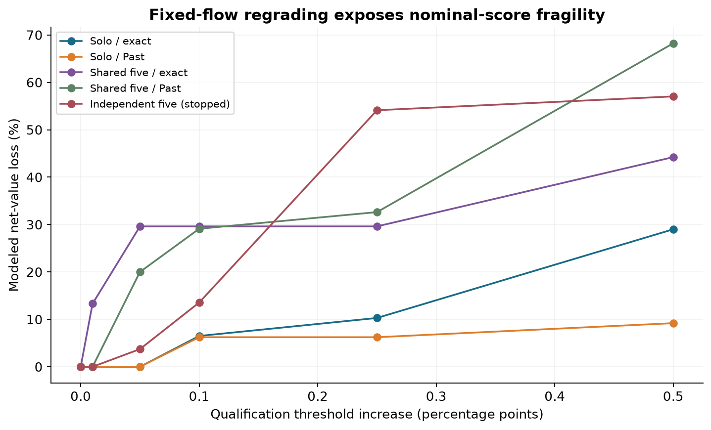

This is a repricing calculation, not a new simulator experiment or a probability of physical failure. It asks how the already measured product streams would be valued under a stricter rule. The result identifies economic sensitivity and motivates an eventual robustness study, but does not establish how the plants would respond to changing feed or operating conditions.

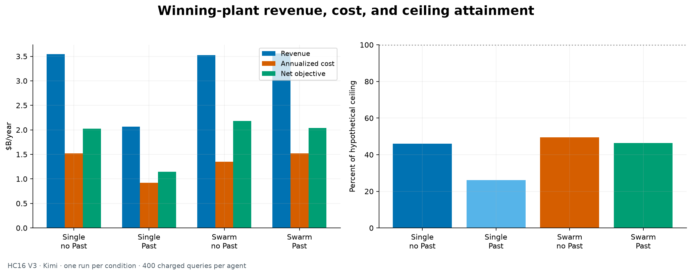

The Past swarm earned slightly more product revenue than the no-Past swarm, but its higher annual costs left less net value. Product purity, recovery, and revenue must therefore be interpreted together with operating and capital costs. [Product-level measurements](results/hc16v3_dev_000/comparison/kimi-k3.1-pro/v3-400-analysis/products.csv) and [grading calculations](results/hc16v3_dev_000/comparison/kimi-k3.1-pro/v3-400-analysis/grade_sensitivity.csv) support this comparison.

## 6. Testing how agents should share

We next compared eight ways of organizing ten Kimi agents on **V3 development task 002**, with 500 total allocated queries. These included independent search, broadcasting the best design, sharing lessons, delayed sharing, different strategies, competing teams, specialist roles, and supervision.

Broadcasting helped all ten agents find positive-scoring plants, compared with four of ten under independent search. But the agents also converged: their final best designs contained just one separation structure, compared with four under independent search and five under delayed sharing.

Broadcasting reached a reward of **2.552**, independent search **2.428**, and delayed sharing **2.436**. A single-agent comparison had already reached **2.656** before a software error stopped it. This experiment therefore did not establish that a swarm outperformed a single agent.

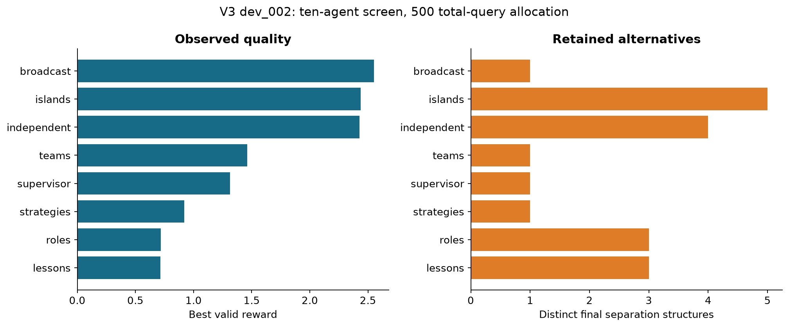

The important observation was the tradeoff between spreading a useful design and preserving alternatives. It led us to test larger groups and island configurations, where agents search in smaller groups with intended exchanges between them. The [configuration descriptions](docs/SWARM_FRAMEWORKS.md) and [screening results](results/results-so-far/v3-screen.html) describe this comparison in detail.

<!-- experiments:v3-screen -->

### Kimi: solo — task 002

**Stopped early.** Best reward **2.6558**, using **256 of 500** allocated queries. Estimated model cost: **$2.96**.

This screening condition had a total allocation of 500 queries. The comparison varies how designs and advice are exchanged, while the final score alone does not measure how many alternatives survived.

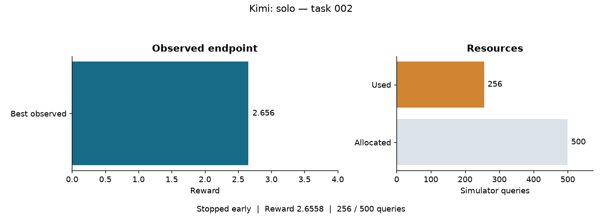

Only the measured endpoint is plotted here; this summary does not establish the path taken to reach it. [Measurements for this run](results/results-so-far/evidence/2d807946da44967f039a.json). Run ID: `hc16v3_dev_002-C0-8713fe15`.

### Kimi: independent — task 002

**Completed.** Best reward **2.4276**, using **484 of 500** allocated queries. Estimated model cost: **$4.08**.

This screening condition had a total allocation of 500 queries. The comparison varies how designs and advice are exchanged, while the final score alone does not measure how many alternatives survived.

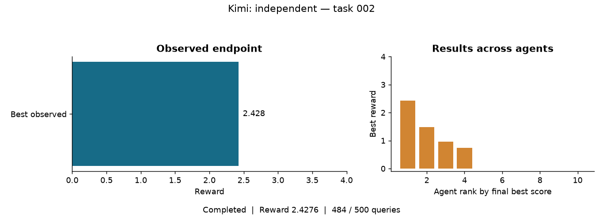

Only the measured endpoint is plotted here; this summary does not establish the path taken to reach it. [Measurements for this run](results/experimental-history-20261115/evidence/swarm-screening/results/swarm-screen-dev002/C1/summary.json). Run ID: `hc16v3_dev_002-C1-f93e9fe6`.

### Kimi: broadcast — task 002

**Completed.** Best reward **2.5520**, using **500 of 500** allocated queries. Estimated model cost: **$3.42**.

This screening condition had a total allocation of 500 queries. The comparison varies how designs and advice are exchanged, while the final score alone does not measure how many alternatives survived.

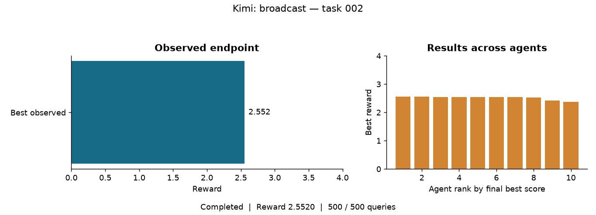

Only the measured endpoint is plotted here; this summary does not establish the path taken to reach it. [Measurements for this run](results/experimental-history-20261115/evidence/swarm-screening/results/swarm-screen-dev002/F1/summary.json). Run ID: `hc16v3_dev_002-F1-60a453c6`.

### Kimi: lessons — task 002

**Completed.** Best reward **0.7151**, using **499 of 500** allocated queries. Estimated model cost: **$4.41**.

This screening condition had a total allocation of 500 queries. The comparison varies how designs and advice are exchanged, while the final score alone does not measure how many alternatives survived.

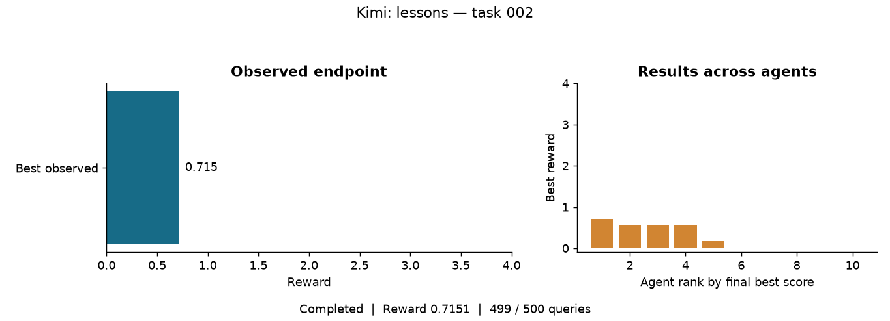

Only the measured endpoint is plotted here; this summary does not establish the path taken to reach it. [Measurements for this run](results/experimental-history-20261115/evidence/swarm-screening/results/swarm-screen-dev002/F2/summary.json). Run ID: `hc16v3_dev_002-F2-7db48d63`.

### Kimi: islands — task 002

**Completed.** Best reward **2.4357**, using **499 of 500** allocated queries. Estimated model cost: **$4.09**.

This screening condition had a total allocation of 500 queries. The comparison varies how designs and advice are exchanged, while the final score alone does not measure how many alternatives survived.

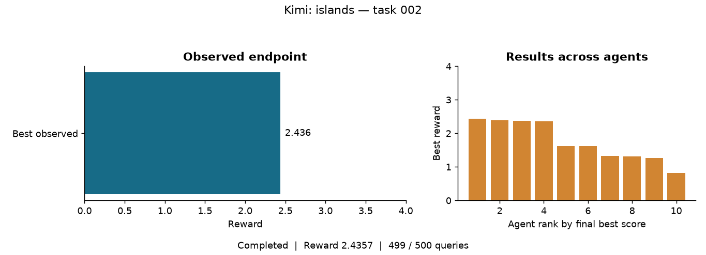

Only the measured endpoint is plotted here; this summary does not establish the path taken to reach it. [Measurements for this run](results/experimental-history-20261115/evidence/swarm-screening/results/swarm-screen-dev002/F3/summary.json). Run ID: `hc16v3_dev_002-F3-46f121e8`.

### Kimi: strategies — task 002

**Completed.** Best reward **0.9206**, using **499 of 500** allocated queries. Estimated model cost: **$3.72**.

This screening condition had a total allocation of 500 queries. The comparison varies how designs and advice are exchanged, while the final score alone does not measure how many alternatives survived.

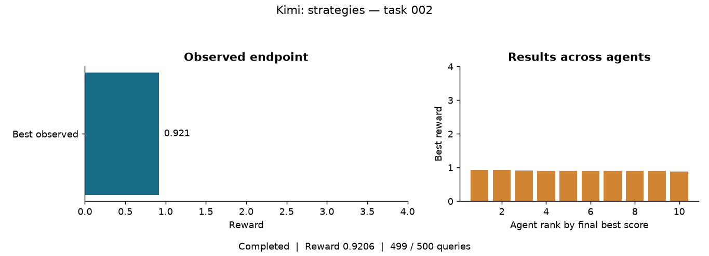

Only the measured endpoint is plotted here; this summary does not establish the path taken to reach it. [Measurements for this run](results/experimental-history-20261115/evidence/swarm-screening/results/swarm-screen-dev002/F4/summary.json). Run ID: `hc16v3_dev_002-F4-3108579c`.

### Kimi: teams — task 002

**Completed.** Best reward **1.4629**, using **500 of 500** allocated queries. Estimated model cost: **$4.01**.

This screening condition had a total allocation of 500 queries. The comparison varies how designs and advice are exchanged, while the final score alone does not measure how many alternatives survived.

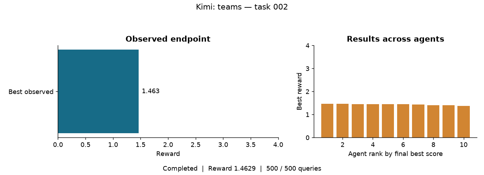

Only the measured endpoint is plotted here; this summary does not establish the path taken to reach it. [Measurements for this run](results/experimental-history-20261115/evidence/swarm-screening/results/swarm-screen-dev002/F5/summary.json). Run ID: `hc16v3_dev_002-F5-972fa1b1`.

### Kimi: roles — task 002

**Completed.** Best reward **0.7167**, using **500 of 500** allocated queries. Estimated model cost: **$3.81**.

This screening condition had a total allocation of 500 queries. The comparison varies how designs and advice are exchanged, while the final score alone does not measure how many alternatives survived.

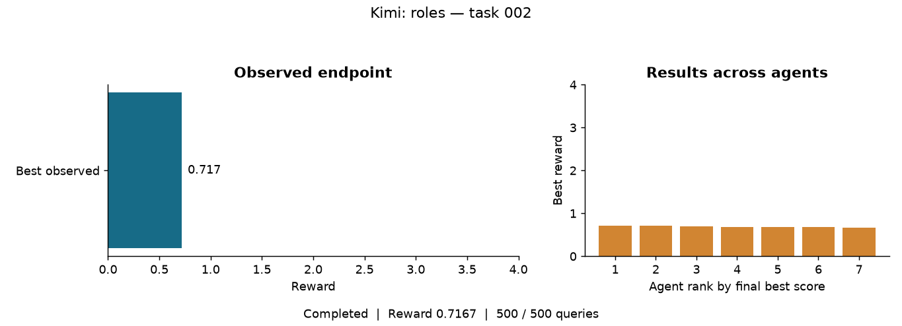

Only the measured endpoint is plotted here; this summary does not establish the path taken to reach it. [Measurements for this run](results/experimental-history-20261115/evidence/swarm-screening/results/swarm-screen-dev002/F6/summary.json). Run ID: `hc16v3_dev_002-F6-ba0e8b10`.

### Kimi: supervisor — task 002

**Completed.** Best reward **1.3121**, using **500 of 500** allocated queries. Estimated model cost: **$2.31**.

This screening condition had a total allocation of 500 queries. The comparison varies how designs and advice are exchanged, while the final score alone does not measure how many alternatives survived.

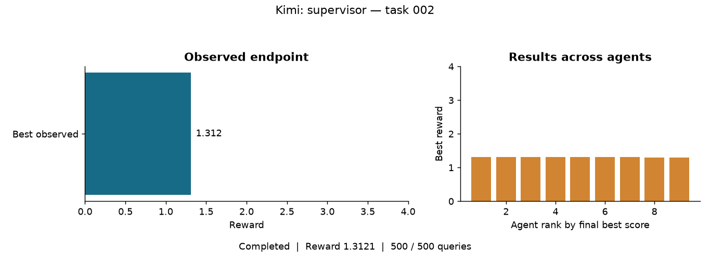

Only the measured endpoint is plotted here; this summary does not establish the path taken to reach it. [Measurements for this run](results/experimental-history-20261115/evidence/swarm-screening/results/swarm-screen-dev002/F7/summary.json). Run ID: `hc16v3_dev_002-F7-d73b7f06`.

<!-- /experiments:v3-screen -->

### What the screening changed

Sharing exact plants was more useful in this screen than sharing abstract lessons alone. Lessons reached 0.7151, while broadcast sharing reached 2.5520. Specialist roles and supervision also failed to improve on broadcast. These outcomes do not prove those approaches are generally ineffective: they describe the particular prompts, budgets, and implementations tested here.

The delayed-sharing condition retained five final structures, while broadcast retained one. Its score, 2.4357, was slightly below broadcast. That combination suggested a useful direction for the next study: preserve several searches long enough to discover alternatives, while still making successful designs available. We tested island arrangements and larger swarms to explore that possibility.

## 7. Final V3 task 002: scaling up the swarms

For the final study, we added full views of other agents’ plants, individual notebooks, and the ability to reuse branches from another design. We compared independent search, open sharing, islands, and other arrangements on development task 002.

The 50-agent island configurations produced the strongest team results for both Kimi and DeepSeek. Kimi’s winning design used **13 column positions**. **49 of its 50 agents** found positive-scoring plants, and their retained best designs contained **16 distinct separation structures**. By comparison, the ten-agent open-sharing run retained one structure. All four ten-agent Kimi conditions exceeded the single-agent score, although they had roughly 500 allocated solves rather than 200.

Opus alone remained the best-performing condition. Its result shows why a stronger single-agent baseline matters: increasing the number of agents is only one way to spend additional resources, and it was not the most efficient option in this comparison.

The experiments also have an important software limitation. They ran before corrections to how designs were selected for exchange and how budgets were transferred in managed search. “Islands” describes the intended configuration; these runs do not isolate the benefit of periodic exchange. DeepSeek also used a thinking cap that Kimi and Opus did not. We therefore report the measured designs and scores without claiming that a particular exchange mechanism caused the improvement.

The [results dashboard](results/results-so-far/final-study.html) links to the saved designs, per-agent activity, and resource use. Seventeen runs finished normally; the DeepSeek culling and managed-search runs reached their round limits and are reported as partial results.

### Kimi: solo, ten-agent configurations, and fifty-agent islands

This comparison separates the observed performance of the configurations within one model. Open sharing led the ten-agent conditions; culling, independent search, and ten-agent islands all scored lower. Fifty-agent islands achieved the strongest Kimi endpoint, but also had five times the allocated budget of a ten-agent run. A claim about the best use of a fixed budget would require another comparison.

<!-- experiments:final-kimi -->

### Kimi: 10 agents, cull — task 002

**Completed.** Best reward **2.4483**, using **497 of 500** allocated queries. Estimated model cost: **$3.06**.

The first positive plant appeared at 256 total solves. 3 of 10 agents found positive plants. The best design used 6 column positions.

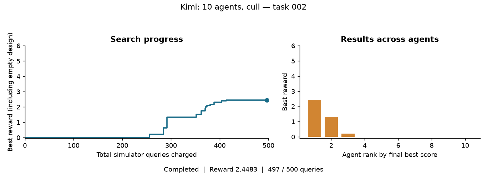

Best-so-far values are shown only through the observed query count; the line is not extended into the unused allocation. [Measurements for this run](results/hc16v3_dev_002/team-cull/kimi-k3.1-pro/hc16v3_dev_002-cull-db97bd5c/report-data.json). Run ID: `hc16v3_dev_002-cull-db97bd5c`.

### Kimi: 10 agents, independent — task 002

**Completed.** Best reward **2.2686**, using **492 of 500** allocated queries. Estimated model cost: **$3.55**.

The first positive plant appeared at 117 total solves. 8 of 10 agents found positive plants. The best design used 4 column positions.

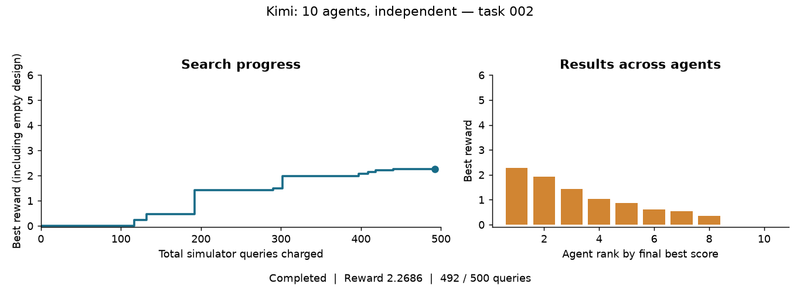

Best-so-far values are shown only through the observed query count; the line is not extended into the unused allocation. [Measurements for this run](results/hc16v3_dev_002/team-independent/kimi-k3.1-pro/hc16v3_dev_002-independent-683a1314/report-data.json). Run ID: `hc16v3_dev_002-independent-683a1314`.

### Kimi: 10 agents, open — task 002

**Completed.** Best reward **2.9537**, using **499 of 500** allocated queries. Estimated model cost: **$6.35**.

The first positive plant appeared at 140 total solves. 10 of 10 agents found positive plants. The best design used 5 column positions.

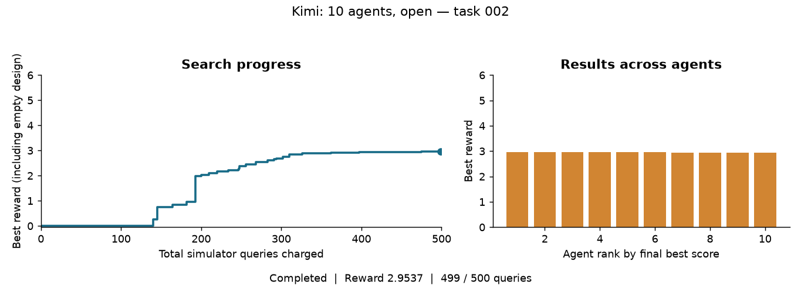

Best-so-far values are shown only through the observed query count; the line is not extended into the unused allocation. [Measurements for this run](results/hc16v3_dev_002/team-open/kimi-k3.1-pro/hc16v3_dev_002-open-41ad914b/report-data.json). Run ID: `hc16v3_dev_002-open-41ad914b`.

### Kimi: 50 agents, ring-5x2-k10 — task 002

**Completed.** Best reward **3.8660**, using **2,496 of 2,500** allocated queries. Estimated model cost: **$23.28**.

The first positive plant appeared at 515 total solves. 49 of 50 agents found positive plants. The best design used 13 column positions.

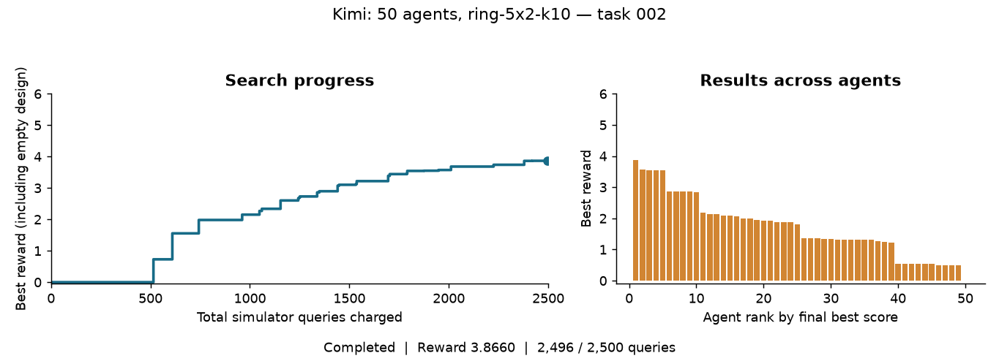

Best-so-far values are shown only through the observed query count; the line is not extended into the unused allocation. [Measurements for this run](results/hc16v3_dev_002/team-ring-5x2-k10/kimi-k3.1-pro/hc16v3_dev_002-ring-5x2-k10-761c0ffe/report-data.json). Run ID: `hc16v3_dev_002-ring-5x2-k10-761c0ffe`.

### Kimi: 10 agents, ring-5x2-k10 — task 002

**Completed.** Best reward **2.2295**, using **498 of 500** allocated queries. Estimated model cost: **$4.19**.

The first positive plant appeared at 128 total solves. 10 of 10 agents found positive plants. The best design used 4 column positions.

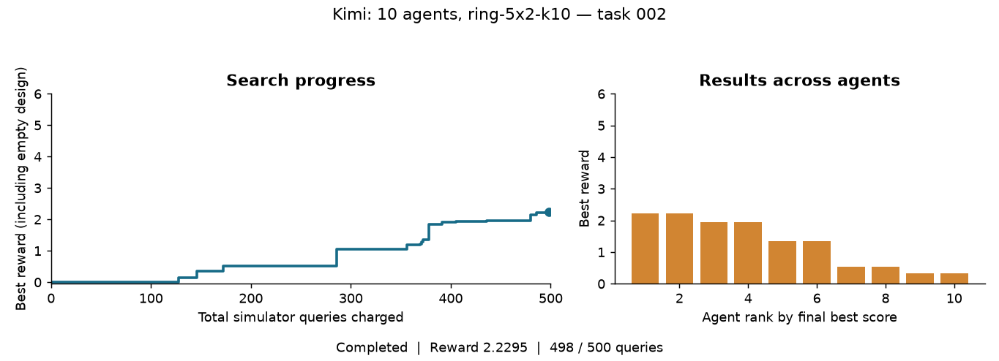

Best-so-far values are shown only through the observed query count; the line is not extended into the unused allocation. [Measurements for this run](results/hc16v3_dev_002/team-ring-5x2-k10/kimi-k3.1-pro/hc16v3_dev_002-ring-5x2-k10-f29cf5a2/report-data.json). Run ID: `hc16v3_dev_002-ring-5x2-k10-f29cf5a2`.

### Kimi: Solo — task 002

**Completed.** Best reward **1.7539**, using **196 of 200** allocated queries. Estimated model cost: **$1.38**.

The first positive plant appeared at 66 total solves. 1 of 1 agents found positive plants. The best design used 5 column positions.

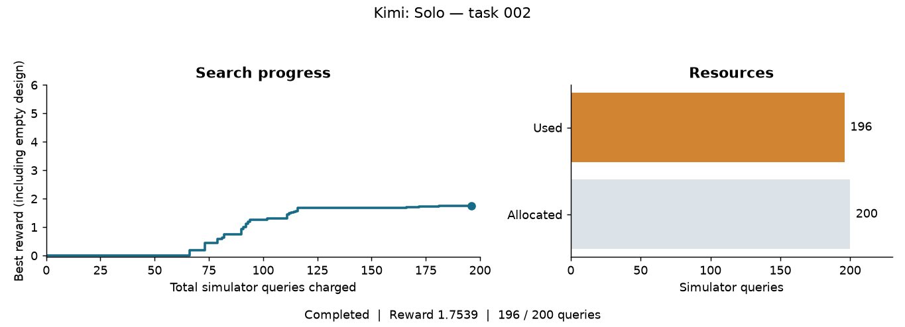

Best-so-far values are shown only through the observed query count; the line is not extended into the unused allocation. [Measurements for this run](results/hc16v3_dev_002/team-solo/kimi-k3.1-pro/hc16v3_dev_002-solo-feca83f5/report-data.json). Run ID: `hc16v3_dev_002-solo-feca83f5`.

<!-- /experiments:final-kimi -->

### DeepSeek: which configurations reached positive designs?

DeepSeek reached positive scores under ten-agent independent search, ten-agent open sharing, and fifty-agent islands. Other completed conditions retained a zero best score. A zero here means the search did not produce a positive-scoring design under the objective; it does not mean that no proposals or simulator evaluations occurred. The individual progress plots make that distinction visible.

Culling and managed search stopped at their round limits, with 299 and 407 consumed solves respectively. They are partial outcomes. The managed condition began with nine workers and 450 allocated solves. These details matter when comparing it with nominally ten-agent configurations.

<!-- experiments:final-deepseek -->

### DeepSeek: 10 agents, cull — task 002

**Partial: round limit.** Best reward **0.0000**, using **299 of 500** allocated queries. Estimated model cost: **$1.37**.

No positive-scoring plant was found. 0 of 10 agents found positive plants. The best design used 0 column positions.

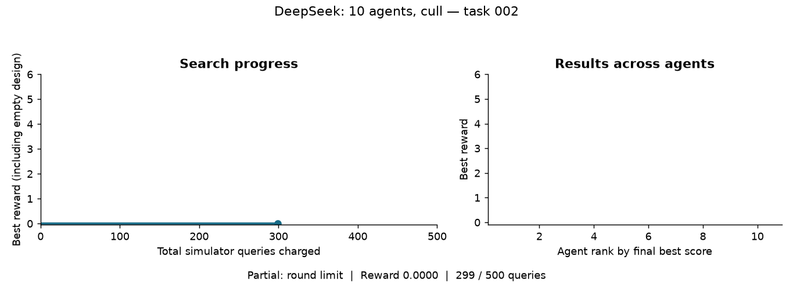

Best-so-far values are shown only through the observed query count; the line is not extended into the unused allocation. [Measurements for this run](results/hc16v3_dev_002/team-cull/deepseek-v4.1-flash/hc16v3_dev_002-cull-2433e454/report-data.json). Run ID: `hc16v3_dev_002-cull-2433e454`.

### DeepSeek: 10 agents, independent — task 002

**Completed.** Best reward **0.6602**, using **493 of 500** allocated queries. Estimated model cost: **$2.27**.

The first positive plant appeared at 390 total solves. 1 of 10 agents found positive plants. The best design used 2 column positions.

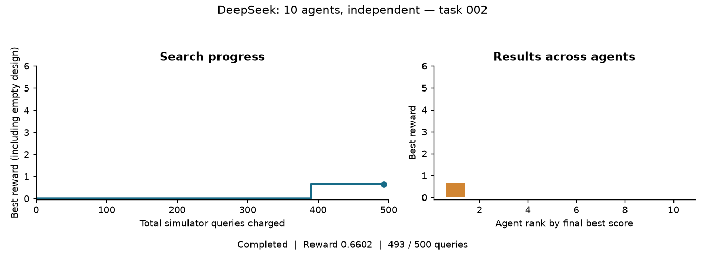

Best-so-far values are shown only through the observed query count; the line is not extended into the unused allocation. [Measurements for this run](results/hc16v3_dev_002/team-independent/deepseek-v4.1-flash/hc16v3_dev_002-independent-3631e4b1/report-data.json). Run ID: `hc16v3_dev_002-independent-3631e4b1`.

### DeepSeek: 9 agents, managed — task 002

**Partial: round limit.** Best reward **0.0000**, using **407 of 450** allocated queries. Estimated model cost: **$1.70**.

No positive-scoring plant was found. 0 of 9 agents found positive plants. The best design used 0 column positions.

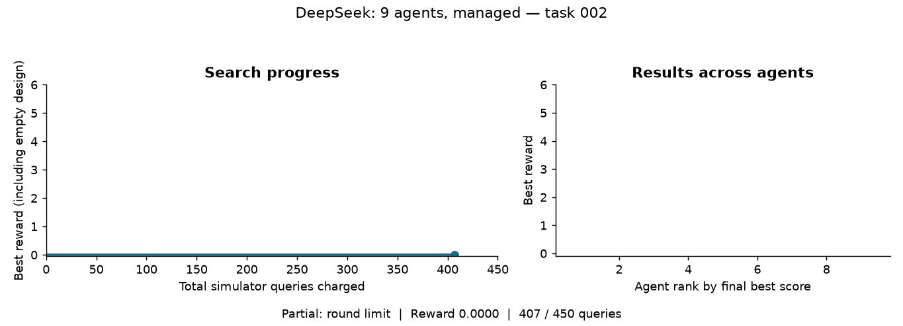

Best-so-far values are shown only through the observed query count; the line is not extended into the unused allocation. [Measurements for this run](results/hc16v3_dev_002/team-managed/deepseek-v4.1-flash/hc16v3_dev_002-managed-f226c55c/report-data.json). Run ID: `hc16v3_dev_002-managed-f226c55c`.

### DeepSeek: 10 agents, niche — task 002

**Completed.** Best reward **0.0000**, using **480 of 500** allocated queries. Estimated model cost: **$1.63**.

No positive-scoring plant was found. 0 of 10 agents found positive plants. The best design used 0 column positions.

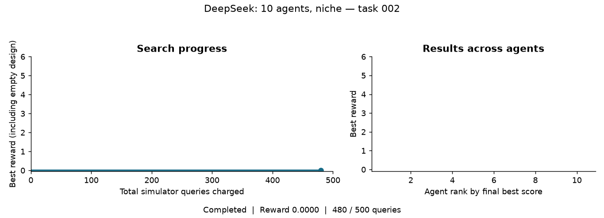

Best-so-far values are shown only through the observed query count; the line is not extended into the unused allocation. [Measurements for this run](results/hc16v3_dev_002/team-niche/deepseek-v4.1-flash/hc16v3_dev_002-niche-20940918/report-data.json). Run ID: `hc16v3_dev_002-niche-20940918`.

### DeepSeek: 10 agents, open — task 002

**Completed.** Best reward **0.8391**, using **464 of 500** allocated queries. Estimated model cost: **$2.67**.

The first positive plant appeared at 431 total solves. 4 of 10 agents found positive plants. The best design used 5 column positions.

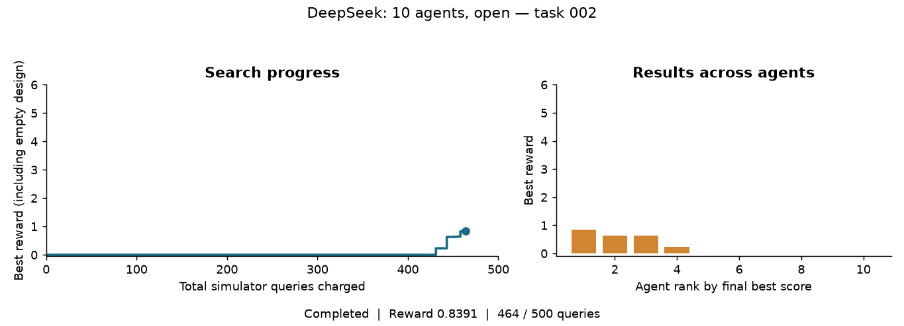

Best-so-far values are shown only through the observed query count; the line is not extended into the unused allocation. [Measurements for this run](results/hc16v3_dev_002/team-open/deepseek-v4.1-flash/hc16v3_dev_002-open-5f533da2/report-data.json). Run ID: `hc16v3_dev_002-open-5f533da2`.

### DeepSeek: 10 agents, open-nocopy — task 002

**Completed.** Best reward **0.0000**, using **484 of 500** allocated queries. Estimated model cost: **$2.08**.

No positive-scoring plant was found. 0 of 10 agents found positive plants. The best design used 0 column positions.

Best-so-far values are shown only through the observed query count; the line is not extended into the unused allocation. [Measurements for this run](results/hc16v3_dev_002/team-open-nocopy/deepseek-v4.1-flash/hc16v3_dev_002-open-nocopy-c2285eb2/report-data.json). Run ID: `hc16v3_dev_002-open-nocopy-c2285eb2`.

### DeepSeek: 10 agents, other-family — task 002

**Completed.** Best reward **0.0000**, using **473 of 500** allocated queries. Estimated model cost: **$2.44**.

No positive-scoring plant was found. 0 of 10 agents found positive plants. The best design used 0 column positions.

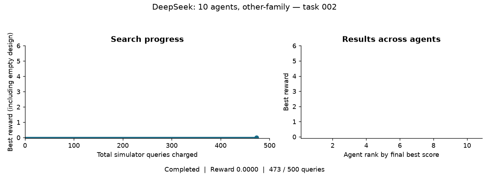

Best-so-far values are shown only through the observed query count; the line is not extended into the unused allocation. [Measurements for this run](results/hc16v3_dev_002/team-other-family/deepseek-v4.1-flash/hc16v3_dev_002-other-family-ec12d65d/report-data.json). Run ID: `hc16v3_dev_002-other-family-ec12d65d`.

### DeepSeek: 10 agents, ring-3isl-k10 — task 002

**Completed.** Best reward **0.0000**, using **454 of 500** allocated queries. Estimated model cost: **$2.12**.

No positive-scoring plant was found. 0 of 10 agents found positive plants. The best design used 0 column positions.

Best-so-far values are shown only through the observed query count; the line is not extended into the unused allocation. [Measurements for this run](results/hc16v3_dev_002/team-ring-3isl-k10/deepseek-v4.1-flash/hc16v3_dev_002-ring-3isl-k10-9d054776/report-data.json). Run ID: `hc16v3_dev_002-ring-3isl-k10-9d054776`.

### DeepSeek: 50 agents, ring-5x2-k10 — task 002

**Completed.** Best reward **2.1601**, using **2,349 of 2,500** allocated queries. Estimated model cost: **$11.96**.

The first positive plant appeared at 482 total solves. 39 of 50 agents found positive plants. The best design used 7 column positions.

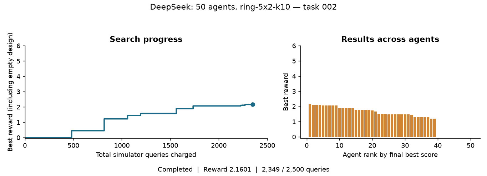

Best-so-far values are shown only through the observed query count; the line is not extended into the unused allocation. [Measurements for this run](results/hc16v3_dev_002/team-ring-5x2-k10/deepseek-v4.1-flash/hc16v3_dev_002-ring-5x2-k10-78e50fff/report-data.json). Run ID: `hc16v3_dev_002-ring-5x2-k10-78e50fff`.

### DeepSeek: 10 agents, ring-5x2-k10 — task 002

**Completed.** Best reward **0.0000**, using **483 of 500** allocated queries. Estimated model cost: **$2.40**.

No positive-scoring plant was found. 0 of 10 agents found positive plants. The best design used 0 column positions.

Best-so-far values are shown only through the observed query count; the line is not extended into the unused allocation. [Measurements for this run](results/hc16v3_dev_002/team-ring-5x2-k10/deepseek-v4.1-flash/hc16v3_dev_002-ring-5x2-k10-90279e64/report-data.json). Run ID: `hc16v3_dev_002-ring-5x2-k10-90279e64`.

### DeepSeek: Solo — task 002

**Completed.** Best reward **0.0000**, using **184 of 200** allocated queries. Estimated model cost: **$0.81**.

No positive-scoring plant was found. 0 of 1 agents found positive plants. The best design used 0 column positions.

Best-so-far values are shown only through the observed query count; the line is not extended into the unused allocation. [Measurements for this run](results/hc16v3_dev_002/team-solo/deepseek-v4.1-flash/hc16v3_dev_002-solo-a3c6b51b/report-data.json). Run ID: `hc16v3_dev_002-solo-a3c6b51b`.

### DeepSeek: 10 agents, strategies — task 002

**Completed.** Best reward **0.0000**, using **458 of 500** allocated queries. Estimated model cost: **$2.19**.

No positive-scoring plant was found. 0 of 10 agents found positive plants. The best design used 0 column positions.

Best-so-far values are shown only through the observed query count; the line is not extended into the unused allocation. [Measurements for this run](results/hc16v3_dev_002/team-strategies/deepseek-v4.1-flash/hc16v3_dev_002-strategies-8574f67c/report-data.json). Run ID: `hc16v3_dev_002-strategies-8574f67c`.

<!-- /experiments:final-deepseek -->

### Opus: the strongest observed single-agent result

The Opus reference reached the highest reward in the final comparison after 74 solves. The remaining allocation was unused because the run finished under its stopping rules. This result anchors the interpretation of swarm scaling: the most successful team still scored lower and consumed far more evaluations than this single-agent search.

<!-- experiments:final-opus -->

### Opus: Solo — task 002

**Completed.** Best reward **5.3313**, using **74 of 200** allocated queries. Estimated model cost: **$2.12**.

The first positive plant appeared at 7 total solves. 1 of 1 agents found positive plants. The best design used 10 column positions.

Best-so-far values are shown only through the observed query count; the line is not extended into the unused allocation. [Measurements for this run](results/hc16v3_dev_002/team-solo/claude-opus-5-5/hc16v3_dev_002-solo-c5cb4e8e/report-data.json). Run ID: `hc16v3_dev_002-solo-c5cb4e8e`.

<!-- /experiments:final-opus -->

## 8. Does requiring an agent to continue help?

A separate Opus experiment on **development task 000** examined continued search. A run required to use at least 80% of its 200-solve allocation reached **2.726 at 160 solves**, while a freely stopping run reached **2.188 at 52 solves**. These were different search trajectories—the longer run was already ahead at 52 solves—so this is not a controlled measurement of the effect of forcing the same agent to continue. The [full results](docs/FINAL_RESULTS.md) keep this comparison separate from the task 002 results.

<!-- experiments:stopping -->

### Opus: Required continuation — task 000

**Completed.** Best reward **2.7258**, using **160 of 200** allocated queries. Estimated model cost: **$4.28**.

The first positive plant appeared at 28 total solves. 1 of 1 agents found positive plants. The best design used 9 column positions.

Best-so-far values are shown only through the observed query count; the line is not extended into the unused allocation. [Measurements for this run](results/hc16v3_dev_000/team-solo/claude-opus-5-5/hc16v3_dev_000-solo-59f2cf1e/report-data.json). Run ID: `hc16v3_dev_000-solo-59f2cf1e`.

### Opus: Free stopping — task 000

**Completed.** Best reward **2.1884**, using **52 of 200** allocated queries. Estimated model cost: **$1.08**.

The first positive plant appeared at 15 total solves. 1 of 1 agents found positive plants. The best design used 8 column positions.

Best-so-far values are shown only through the observed query count; the line is not extended into the unused allocation. [Measurements for this run](results/hc16v3_dev_000/team-solo/claude-opus-5-5/hc16v3_dev_000-solo-f9b1e6f5/report-data.json). Run ID: `hc16v3_dev_000-solo-f9b1e6f5`.

<!-- /experiments:stopping -->

The forced-continuation run already had a different score at the freely stopping run’s endpoint. The additional evaluations and the different path cannot be separated in this comparison. A controlled follow-up would resume the same saved state with and without the stopping restriction, with repeated trials. The figures above document what happened in these two searches without attributing the entire difference to the rule.

## 9. Examining the content of shared memory

A follow-up experiment tested a new shared library of compact experiment records. On development task 000, the five-agent immediate-sharing condition reached **0.521 at 1,990 queries**, compared with **2.324 at 395 queries** for the single agent. Recorded model costs were **$24.24** and **$4.73**, respectively. At the same 395-query point, the swarm had reached only **0.394**.

All five agents’ final best plants had the same topology. Records from the shared library did reach the prompts, but the selection method rotated through examples in insertion order without ranking their quality, recency, or relevance. Nearly all prompts approached the size limit.

These observations point to a question about the quality of the information agents receive, rather than simply how much is stored. They do not establish why the swarm performed poorly. Both completed runs passed the recorded accounting, objective, and material-balance checks. A delayed-sharing attempt was stopped shortly after starting, and a second delay condition was never started, so neither supports a comparison of sharing timing. The [follow-up analysis](results/results-so-far/corpus-comparison.html) contains the measurements and remaining uncertainties.

<!-- experiments:v3-corpus -->

### Kimi: Five agents, immediate library sharing — task 000

**Completed.** Best reward **0.5209**, using **1,990 of 2,000** allocated queries. Estimated model cost: **$24.24**.

The shared-library configuration is a separate experiment from the earlier memory controls. Its result should not be treated as a repeat under identical settings.

Best-so-far values are shown only through the observed query count; the line is not extended into the unused allocation. [Measurements for this run](results/results-so-far/corpus-evidence/sharing_immediate/screening-audit.json). Run ID: `swarm-15b64983de0a4bb0b40c91cca8b7f55f`.

### Kimi: Solo, compact experiment library — task 000

**Completed.** Best reward **2.3238**, using **395 of 400** allocated queries. Estimated model cost: **$4.73**.

The shared-library configuration is a separate experiment from the earlier memory controls. Its result should not be treated as a repeat under identical settings.

Best-so-far values are shown only through the observed query count; the line is not extended into the unused allocation. [Measurements for this run](results/results-so-far/corpus-evidence/single_baseline/screening-audit.json). Run ID: `swarm-292bd96a0f944b1083b637e2b08633fe`.

<!-- /experiments:v3-corpus -->

### What reached the agents, and what they did with it

In the immediate-sharing run, 611 of 763 submissions explicitly selected a source design. Of those submissions, 484 used a peer source and 127 used an own-agent source. There were 189 exact duplicate submissions. Across the proposals, 33 sets of column positions were explored, yet all five agents’ final best plants had the same topology. This shows substantial reuse alongside some exploration, not an absence of experimentation.

The stored library grew to 565 keys and 727 observations. Of 15,025 candidate-source instances, 7,427 were admitted to prompts; these are repeated opportunities to include information, not counts of unique experiments. Admitted non-incumbent sources had a median age of 66 rounds. The selector did not explicitly prioritize useful improvements or fresh evidence.

The winning shared plant had four column positions and about $432.5 million in simulated annual net value. The solo winner had 13 positions and about $1.929 billion. The smaller shared plant cost less, but gave up much more revenue. The low reward is consistent with its measured economics. It is not explained by a discrepancy in reward normalization.

These diagnostics suggest specific questions for the next controlled experiment: which past results should be selected, how should their relevance be described, and how can agents keep exploring alternatives after a useful shared design appears? The present runs cannot identify which of those changes would have altered the outcome.

## Conclusions and limitations

Our experiments demonstrate an autonomous design loop: agents propose chemical plants, evaluate them, and use the results to revise their designs. Larger swarms found better team designs in the final comparison, but the strongest single agent achieved a higher score with substantially fewer simulator solves.

Sharing has two visible effects. It can spread a successful design to agents that would otherwise struggle, and it can concentrate their search around that design. Adding retrieval did not improve the completed memory comparison, and the later shared-library experiment performed worse than its single-agent baseline. More stored experience is therefore not sufficient; the selection and presentation of that experience deserve separate testing.

These studies used single runs, unequal budgets, and different task instances and software settings. They establish observed outcomes, not reliable estimates of average performance or proof of a particular mechanism. Repeated comparisons on the same task, with the corrected software and equal total budgets, would help separate the effects of group size, information selection, and exchange timing.

## Data and methods

The repository includes [experiment reports and saved designs](results/results-so-far/inventory.html), a [numerical appendix](results/results-so-far/ANALYSIS.md), and [instructions for reproducing and inspecting runs](docs/GETTING_STARTED.md). Individual reports link to the available measurements and logs. Some early experiments retain summaries without complete trajectories; later final-study reports include plant submissions and usage records. Live evaluations require ChemSep, while saved results and 3D plants can be inspected locally.

The individual experiment figures can be regenerated from the included data with `python scripts/plot_research_experiments.py`, after installing `requirements-report.txt`. Run `python scripts/render_results_summary.py` to refresh the HTML report. These commands do not call models or run the simulator.
