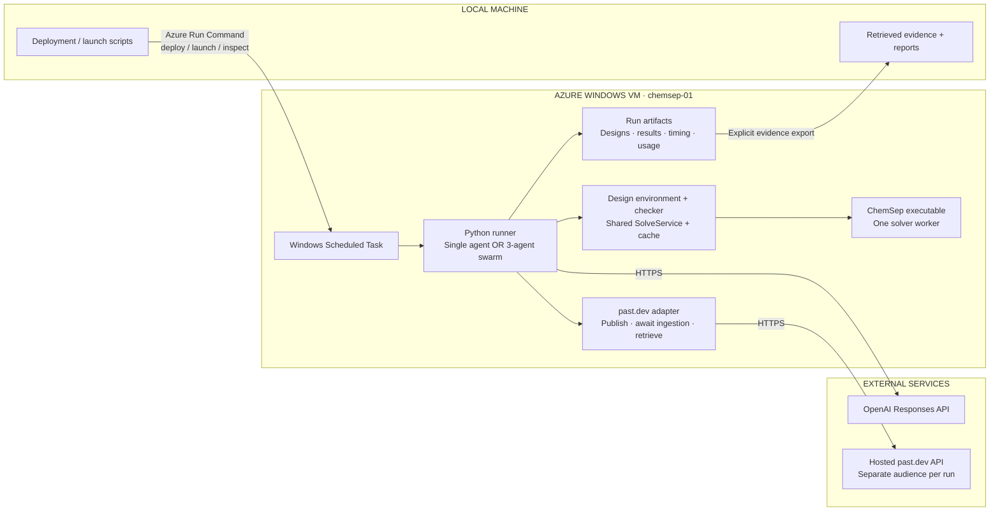

# Deployment architecture

November 14, 2026. The persistent VM runtime is merged. The swarm runner and
past.dev adapter are in PR #3 and have been deployed to an isolated VM directory
for live validation. Each run has its own artifacts and memory scope.

The single-agent runner is `scripts/run_vm_agent.py`. The swarm runner is
`scripts/run_swarm.py`, using `sepdesign/swarm.py` and
`sepdesign/swarm_memory.py`. Both use `agents/llm_agent.py` for model calls.
The swarm creates separate design environments and ledgers for each agent,
sharing one simulator service/cache. Model proposals run concurrently; all
submissions are evaluated and published before the next round retrieves memory.
There is no coordinator model.

Credentials are read from a restricted VM env file. Only SYSTEM and
Administrators have file access. Source bundles and exported evidence exclude
credentials. past.dev uses TLS certificate verification with Windows native trust.

The older Luna/Sol pilots run the model loop locally and invoke Azure for each
submission. The persistent runtime removes that per-submission transport;
Azure commands are still used for setup and evidence retrieval.

Existing pilot HTML includes interactive flowsheet replay. Persistent and swarm
artifacts retain evidence but still need integration with the same report format.
See `results/azure-runtime/sol-five-call/` for the completed real five-call timing
test. Live swarm evidence is recorded separately; deployment alone is not success.
