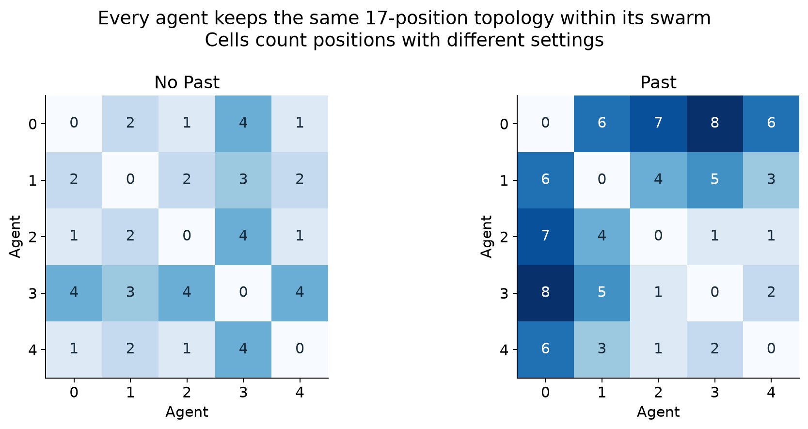
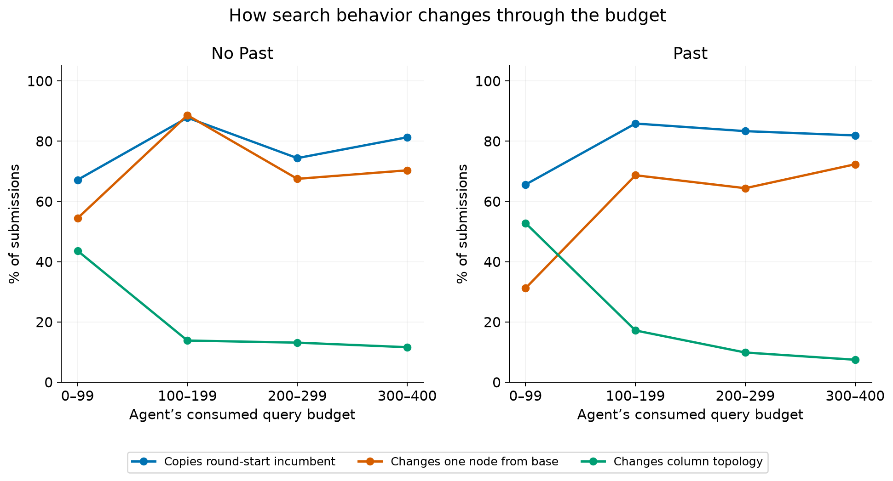
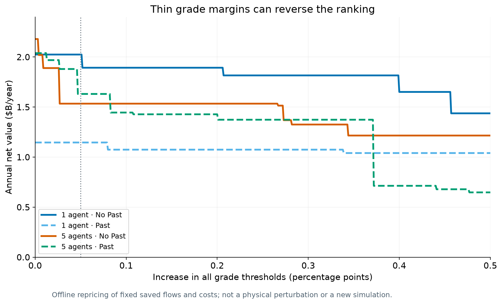

# V3: swarm behavior, product economics, and the next experiments

The strongest interpretation is **shared-incumbent search with frequent local edits**, rather than five independent researchers. Sharing spreads useful improvements, but also makes the agents converge on one plant family. This is observed behavior in one completed run per condition, not an estimate of a general swarm or memory effect.

[Back to the interactive report](index.html) · [Behavior evidence JSON](behavior-data.json) · [Behavior metrics CSV](behavior_rates.csv) · [Grade sensitivity CSV](grade_sensitivity.csv)

## 1. Are they copying?

Yes. Explicit peer copying occurs in about 68% of submissions in both swarms. Copying here means selecting another agent’s saved full design as `source_design`; it does not mean submitting that design unchanged. Most selections are followed by edits. The no-Past condition is exact incumbent/recent-result sharing, not independent search.

| Swarm | Submissions | Copies a peer | Selects round-start incumbent | Exact duplicate design | Changes one node from selected base | Changes column paths | Valid result below own retained best |
|---|---:|---:|---:|---:|---:|---:|---:|
| No Past | 642 | 436 (67.9%) | 490 (76.3%) | 91 (14.2%) | 437 (68.1%) | 145 (22.6%) | 360 (56.1%) |
| Past | 450 | 304 (67.6%) | 354 (78.7%) | 59 (13.1%) | 260 (57.8%) | 103 (22.9%) | 217 (48.2%) |

Copying also supports genuine collaboration: all five agents contributed new team bests in each swarm. Of the positive team-improvement events, 58 of 87 without Past and 56 of 79 with Past explicitly built on a peer design. This is observed lineage, not proof the same improvement could not have been found independently.

All percentages use all submitted attempts as denominator. A base is the explicitly selected source design, or the agent’s previous current design when no source is selected. A path change means adding/removing a column position. This metric does not classify parameter magnitude, a side-draw/double-effect change on an existing position, or a revert as a genuinely new strategic direction. Duplicate design means the runner’s exact-design fingerprint had appeared earlier; it does not measure all repeated column queries. Source selection is counted even if a later edit is rejected.

## 2. Is there no variability?

There is variation in settings, but little endpoint variation in structure or score. Within each swarm, all five retained best designs have the same 17 column positions. Every retained best design is distinct. In the no-Past swarm, 13 of 17 positions have exactly the same settings across all agents; in the Past swarm, 9 of 17 do. The ranges in retained reward are only 0.103% and 0.0345% of the respective best rewards.

This distinction matters: Past has a narrower score range but more endpoint setting variation by this particular metric. Similar score trajectories alone are not evidence that all proposed actions were identical. Nor do five similar endpoint scores constitute five independent replications.

The two swarms themselves converge to different plant families. No-Past retains four double-effect positions (21 physical columns across 17 positions); Past retains none (17 physical columns). The no-Past plant recovers about 92 MW through the modeled heat links.

## 3. Are they greedy? How conservative are the actions?

The harness uses greedy retention of the best score and always shows the shared incumbent, but does not implement a strict greedy action-selection or acceptance algorithm. Worse valid candidates and invalid plants are evaluated; the current state is not automatically restored after a worse result. An agent must choose a saved source or explicitly revert. The visible best-so-far curves are monotone by construction and conceal unsuccessful experiments.

The observed behavior is consistent with incumbent-centered local search: repeatedly copy a successful plant, adjust settings, retain the best, and try another adjustment. Late improvement notes explicitly describe small stage or duty trims. The notes are the models’ stated rationales, not verified explanations or access to their private reasoning.

Past was not uniformly more conservative: 18.7% of its submissions changed at least three positions from the selected base, versus 10.7% without Past; root settings changed in 18.0% versus 4.4%. Column-path changes were almost equal overall (22.9% versus 22.6%). These are descriptive distances, including any restores, and do not identify useful novelty.

Large structural exploration does occur, especially earlier. A lower current reward is evidence of testing a worse candidate, not proof the agent intentionally planned a multi-step escape from a local optimum. Likewise, adding columns is not automatically a radical change. To measure that better, classify edits into topology changes, duty/stage changes, lever switches, reverts, and copied designs, then measure normalized parameter distance and protected branch depth.

The no-Past swarm reached 99% of its eventual best at 1,335 team queries, leaving 643 charged queries for its final 1%. The Past swarm reached 99% at 1,431, leaving 532. These hindsight checkpoints suggest diminishing returns and motivate lower-budget experiments; they are not prospective stopping rules.

## 4. Why did Past finish worse?

The result does not establish that the memory service is intrinsically harmful. The comparison is extra retrieval on top of an already strong exact-sharing channel, with stochastic single runs and recovery changes to the deployed code.

- **A different plant family is the immediate economic explanation.** The Past swarm earns about $29.6M/year more revenue than no-Past, but costs about $170.4M/year more, leaving net value $140.8M/year lower. More premium product is not automatically more profit. The winning no-Past design uses heat integration; the Past winner does not. This is an accounting observation, not a causal ablation of double effect.
- **The Past single leaves a large opportunity unexploited.** None of six C6 species enters priced qualifying products. Its notes focus on recovering light blends and polishing heavy products. Material is conserved, but the selected train never monetizes much of the middle fraction. This supports an unfavorable search path; it does not prove memory caused that path.
- **Retrieved content faces a second, tighter admission bottleneck.** About 78% of candidate memory instances for the Past single and 86% for the Past swarm are omitted by the local prompt builder. State and the incumbent are mandatory; recent exact results take precedence. Every logged prompt includes the incumbent. These omission counts are repeated instances across prompts, not unique memories.
- **The system is searching while ingestion lags.** The completed Past single and swarm leave 75 and 26 ingestion jobs pending. The adapter is nonblocking: it polls but does not wait for all extraction to finish. Past’s API distinguishes accepted data from memory ready for recall and recommends settled ingestion when evaluating recall on new data. An online asynchronous trial measures available-in-time memory; a settled replay tests retrieval quality separately. [Past recall and ingestion contract](https://past.dev/docs/memory-api/api-reference)
- **Less total spend does not mean cheaper decisions.** Past uses about 35% more input tokens per request for the single and 17% more for the swarm. It makes fewer submissions: 181 versus 237, and 450 versus 642. The swarm consumes 4.36 charged queries per submission versus 3.08. Total model spend is lower because there are fewer requests, while per-request model cost is higher.
- **Waiting alone does not explain the score gap.** The Past swarm actually finishes faster than the no-Past swarm, despite approximately 4.8 minutes of logged memory operations. Neither stops on a wall-time budget. Latency affects usefulness and freshness, but cannot by itself explain poorer endpoints at these fixed query allocations.

The V2 audit’s missing-local-history and missing-incumbent defects should not be carried forward as explanations for these V3 results. Deployed V3 code restores local history/errors and guarantees the incumbent. The original and recovered prompt code differ in recall-query truncation, not in these guarantees. Source files were checked against every completed run’s saved hashes.

## 5. What do the applicable-product-grade charts imply?

Grade is the fraction that qualifies for the stream’s selected sale category: an individual species for pure/premium products, or the sum of allowed members for a blend. A 95% C6 blend is not 95% pure hexane. Grade is also distinct from physical recovery: a tiny pure stream can recover little of the feed.

The task pays ordinary pure products at 95%, premium products at 99% with a 20% multiplier, and qualifying blends at their specified threshold and discount. It does not require complete recovery of every component. Agents can rationally leave some material unpriced and trim duties toward the grade boundary. Ethane has zero qualifying product recovery in every completed winner.

The no-Past swarm’s three fragile C6 paraffin blends are approximately 95.003%, 95.009%, and 95.027% against a 95% threshold. Together they contribute about $645.5M/year in revenue. The models’ late trimming behavior exploits these sharp economic boundaries.

An offline sensitivity check holds all saved physical flows and plant costs fixed, raises all qualification thresholds, and recomputes the best eligible selling category—including fallback from premium to ordinary pure or blend pricing.

| Increase in grade thresholds | Single, no Past: net loss | Single, Past: net loss | Swarm, no Past: net loss | Swarm, Past: net loss |
|---|---:|---:|---:|---:|
| 0.01 percentage points | 0% | 0% | 13.3% | 0% |
| 0.05 percentage points | 0% | 0% | 29.6% | 20.0% |
| 0.10 percentage points | 6.5% | 6.2% | 29.6% | 29.1% |

At +0.05 percentage points, the single without Past becomes the best of these fixed designs. This is not a probability of failure, a numerical-error estimate, or a physical perturbation test. It identifies economic exposure to narrow margins. There is no evidence here that the solver is wrong or that the agents violated the benchmark.

Useful next charts: grade headroom in percentage points versus annual revenue at risk; per-component qualifying recovery; revenue and annualized cost decompositions; and nominal versus perturbed net value. The latter needs actual feed/temperature/pressure/solver-tolerance perturbations and replay, not only repricing. A deployment-oriented objective should make the required grade safety margin or risk criterion explicit.

## 6. Does the round architecture make sense?

For a controlled experiment, synchronized rounds give every proposal the same evidence cutoff and reproducible ordering. That is useful. For throughput and exploration, this implementation has several avoidable constraints:

1. Every model proposal must finish before any proposed plant is evaluated. Model inference and the one simulator worker do not form a pipeline.
2. Proposals are evaluated in agent-ID order. All agents then see a guaranteed incumbent, encouraging fast propagation and convergence.
3. The exact recent packet contains the last four records, not one record per agent. In a full five-agent round with five accepted publications, agent 0’s latest result is omitted from that packet unless it is the incumbent. In the no-Past run, source-exposure counts were 245 for agent 0 versus 625–717 for the others; these count repeated exact-source appearances, not unique evidence or causal influence. Rejections and late-run exits change this pattern. This is a verified selection rule, not a proven explanation of the outcome.
4. Ingestion is asynchronous, but publication, status polling, and serial per-agent recall still lie between proposal rounds.
5. There are no experiment reservations, assigned hypotheses, protected alternative branches, or novelty-based work allocation. The process rewards adopting the leader more directly than preserving independent exploration.

A sensible next design is a small portfolio of protected branches with a shared exact result store. Keep one exploitation branch and allow other branches several experiments before requiring comparison with the incumbent. Reserve proposed experiments to avoid accidental duplicates; make identical cached results cheaply reusable while accounting separately for inherited and novel queries. Retrieve memory about a specific decision or failure, and record whether the retrieved evidence changes that decision.

Test pipelined or asynchronous evaluation separately from the diversity policy. Use a versioned evidence cutoff per proposal, keep the simulator serialized where required, and measure staleness, model wait, simulator idle time, discovery rate, and budget fairness. Removing the round barrier is not itself a solution to convergence.

## 7. What should we run next?

Do not expand every axis at once. The highest-value sequence is:

| Priority | Experiment | Question answered |
|---|---|---|
| 1 | Finish and analyze the already-launched independent five-agent control | Does sharing beat best-of-five independent search at the same depth and total budget? |
| 2 | Repeat single/exact-five/Past-five/independent-five under frozen source and task | How much of the observed ranking is run-to-run variation? Start with three runs per condition as a variance pilot, then size further repeats from the variance and effect of interest. |
| 3 | Equal-total 400-query comparison: 400 for one agent, 80 each for five | Is parallel search worth the reduced depth when total simulator allowance is fixed? Three repeats of four arms allow at most 4,800 charged queries. This addresses a different regime than the current 400-per-agent experiment. |
| 4 | Current sharing versus protected branches, with identical model and budgets | Does preserving topology/hypothesis diversity improve the incumbent? |
| 5 | Exact-only versus bounded deterministic archive retrieval versus Past retrieval | Does retrieval add useful evidence beyond the current incumbent/recent packet? Match evidence budgets and separate settled retrieval quality from online ingestion latency. |
| 6 | Announced lower budgets and a three-agent swarm | Where is the useful depth/breadth tradeoff? Historical prefixes are informative but agents knew they had 400 queries each. |
| 7 | A cheaper-model or mixed-model pilot on the strongest architecture | Can cost fall without increasing invalid proposals, missed grade opportunities, or query waste? Compare complete search cost and success, not token price alone. |
| 8 | Larger teams and more task instances | Scale only after marginal independent discovery improves; more agents copying the same branch may buy little. Test different feeds/economics before claiming generality. |

Repeats should randomize deployment order and preserve task, source, model settings and budget rules; use independent model randomness where controllable. Do not treat agent endpoints within a sharing swarm as independent samples. Three repeats are a pilot, not adequate evidence for small effects. Include operational failures and rerun costs in reliability reporting.

A non-LLM local-search or multistart baseline under the same simulator accounting is also missing. It is needed to determine whether the system’s advantage comes from engineering knowledge, its search policy, or simply more evaluations. The ideal revenue ceiling is not an achievable optimal-plant reference.

For a clean 400-per-agent replication across the four main arms, the maximum allowance is 6,400 charged queries per replicate (400 + 2,000 + 2,000 + 2,000), or 19,200 for three fresh replicates. That larger test targets the current regime; the smaller equal-total pilot is not a substitute for it. No new paid runs were launched for this investigation.

## Evidence and limitations

The behavioral export reads saved trajectory events on the VM, checks their hashes against the existing analysis snapshot, and exports counts, design distances, prompt diagnostics, round diversity and improvement rationales. The analysis does not inspect hidden model reasoning. Explicit source copying is observable; uncited imitation through visible settings or prose is not fully attributable. Comparison of notes does not identify a causal memory mechanism.

The definition of “column topology” here is the set of column paths. Parameter distance counts changed whole-node settings, without weighting stage changes against pressure or duty changes. Reverts and rejected proposals can affect these counts. More detailed action-intent classification remains necessary before making strong claims about radical versus conservative exploration.

The independent control was confirmed launched from the local controller/snapshot during this investigation, but is not included in these four-condition endpoint comparisons. Its live partial score should not be compared with completed endpoints.

Artifacts: [raw behavioral projection](behavior-data.json), [source-hash index](provenance/behavior-source/index.json), [exact design distances](final_design_distance.csv), [hindsight saturation checkpoints](search_saturation.csv), [reproducible diagnostic builder](provenance/analyze_v3_behavior.py), [grade repricing table](grade_sensitivity.csv), and the original [evidence](report-data.json).

## Additional measured behavioral statistics

### swarm without past

- Source selections: 550; unchanged copies: 43; copies followed by a design change: 507.
- Valid copied results better than their source: 96; worse than source: 369.
- Positive team-improvement events: 87; based on an explicit peer copy: 58. This is lineage, not a counterfactual estimate of memory benefit. Within-round attribution depends on evaluation order.
- Three-or-more changed positions: 69/642; root settings changed: 28/642. These may include restores or rejected edits.
- Median copied-source age: 1.0 rounds.
- Sum of per-round maximum model time: 33.6 min; sum of per-round mean model time: 21.5 min. Their difference describes round imbalance, not a predicted asynchronous speedup.

### swarm with past

- Source selections: 382; unchanged copies: 32; copies followed by a design change: 350.
- Valid copied results better than their source: 106; worse than source: 205.
- Positive team-improvement events: 79; based on an explicit peer copy: 56. This is lineage, not a counterfactual estimate of memory benefit. Within-round attribution depends on evaluation order.
- Three-or-more changed positions: 84/450; root settings changed: 81/450. These may include restores or rejected edits.
- Median copied-source age: 1.0 rounds.
- Sum of per-round maximum model time: 26.6 min; sum of per-round mean model time: 16.1 min. Their difference describes round imbalance, not a predicted asynchronous speedup.

## Independent control update

The user-stopped independent control is now analyzed separately from completed runs. [Updated five-condition comparison](independent.html) · [Analysis and caveats](independent-analysis.md). The original findings above remain a historical four-condition analysis.
