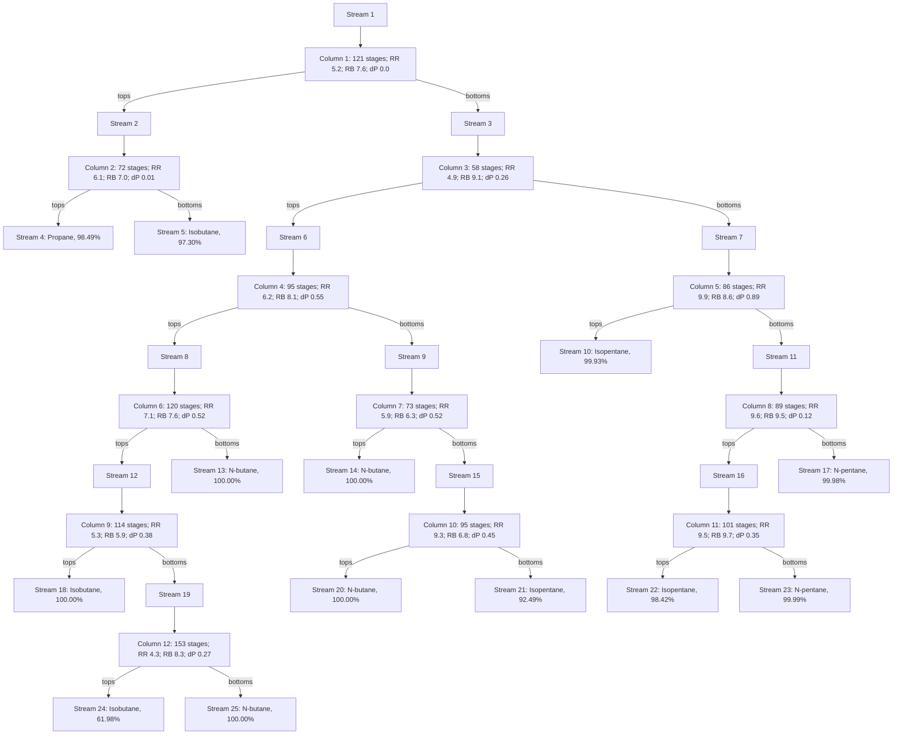

# Live 12-column reference replay

Executed 2026-11-14 on chemsep-01. This is a simulator reference check, not an agent experiment.

- **Execution:** 12 fresh column calls, zero cache hits, 74.2 seconds including worker description and accounting; Azure command delivery adds overhead.
- **Economics:** annual revenue $1,488.053M; annualized cost $116.419M; net $1,371.634M under the upstream benchmark assumptions.
- **Reference agreement:** 12 successful columns, no unresolved streams; annualized cost matches exactly and revenue differs by less than $0.000001/year.
- **Specification:** two terminal streams remain below the existing 95% purity cutoff; upstream spec_success is false.
- **Physics:** all columns converged. Eleven of twelve pass the initial component balance check (absolute 1e-6 mol/s + relative 1e-7 of component inlet). The column fed by stream 6 fails; do not label this an unconditional physics pass.
- **Overall closure:** maximum absolute component residual 3.5e-05 mol/s, using the upstream six-decimal stream rounding.
- **Limit:** energy balance is not independently verified; heat duties alone do not provide inlet/outlet enthalpy closure.

The flagged residuals are isopentane (2.56e-5 mol/s; 0.31 ppm of its inlet) and n-pentane (1.38e-6 mol/s; 0.50 ppm), both in the column fed by stream 6. All raw outlet flows are finite and nonnegative. These small residuals need an explicit numerical-tolerance decision; they do not demonstrate a gross conservation failure.

## Product outcomes

Recovery below counts a component only in on-spec terminal streams where it is the dominant component. Purity range describes those individual product streams, not a blended product.

| Component | On-spec product purity | Component recovery |
| --- | --- | --- |
| Ethane | No dedicated product | 0.00% |
| Propane | 98.492–98.492% | 98.36% |
| Isobutane | 97.296–100.000% | 96.64% |
| N-butane | 99.996–100.000% | 92.31% |
| Isopentane | 98.423–99.934% | 75.88% |
| N-pentane | 99.985–99.993% | 97.86% |

Ethane remains in other streams; 0% dedicated-product recovery does not mean its mass disappeared.

## Off-spec outlets

| Stream | Main component | Purity | Flow (mol/s) |
| --- | --- | --- | --- |
| 21 | Isopentane | 92.490% | 89.367 |
| 24 | Isobutane | 61.976% | 64.575 |

The upstream stream-limit rule terminates these outlets. Treating them as residual streams versus requiring further separation is an explicit design-brief decision.

## Historical implications for the experiment

These notes predate the frozen HC12 economic brief. That brief subsequently chose no recovery minima and allowed zero-value residuals; the proposed five-product brief below was not adopted.

- Keep this as a reproducible economic reference, not a feasible example of recovering all six components as pure products.
- A five-product brief with ethane allowed as an impurity/residual is a candidate, not yet an agreed requirement.
- Freeze recovery thresholds and residual-stream rules before evaluation; reference isopentane recovery is about 75.9%.
- Investigate and justify numerical tolerances before freezing the checker. Do not silently relax them to make the reference pass.

## Flowsheet

Machine-readable data: report.json; raw column trace: reference.calls.jsonl; independent check results: validation.json. Scripts: infrastructure/azure/replay_reference.py and summarize_reference.py. Simulator service and accounting library are still dependencies of the existing Windows installation; their fingerprints are recorded in report.json.
